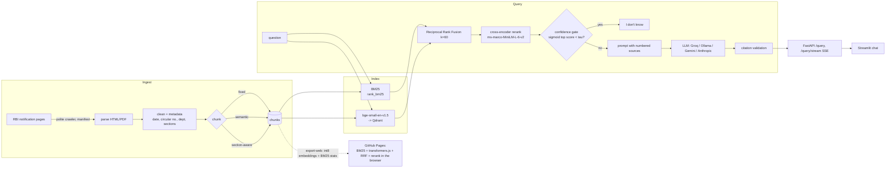

# rbi-circulars-rag

Hybrid-retrieval RAG over 2,000+ Reserve Bank of India notifications. It answers with
numbered citations to the source notifications and says "I don't know" when retrieval
confidence is low. The evaluation (retrieval and generation metrics, ablations,
bootstrap confidence intervals) is the centrepiece.

- **Live demo (browser-only search, optional answers with your own key):**
  https://srini2k03.github.io/rbi-circulars-rag/ (published by `pages.yml`)
- **API + chat UI:** `docker compose up` (see [Run it](#run-it))

Every number in this README comes from a real run recorded in `results/run_metadata.json`
(date, commit, judge model, test-set label). Nothing is filled in by hand.

## Architecture



## Results

<!-- RESULTS:START (generated by `rbirag eval report --update-readme`) -->
**Test set: model-generated test set (`data/eval/qa_candidates.jsonl`): 216 model-generated pairs (43 AI-reviewed by Claude, 0 human-verified); 7 AI-rejected pairs excluded.** Generated 2026-11-04T11:38:08+00:00 at commit `178124e`; judge: qwen/qwen3.8-27b 81%, openai/gpt-oss-120b 19%.

**Split by document:** 155 test questions (130 documents) for every reported number; 61 dev questions (56 documents) used only to choose configurations and calibrate the gate. No document contributes questions to both.

Retrieval, top 5 of 36 configurations by chunk-level nDCG@10 (95% bootstrap CIs):

| config | chunks | doc R@5 | chunk R@1 | chunk R@5 | chunk R@10 | chunk MRR@10 | chunk nDCG@10 [95% CI] | p50 ms |
|---|---|---|---|---|---|---|---|---|
| fixed-512-bm25 | 10131 | 0.846 | 0.531 | 0.800 | 0.881 | 0.650 | 0.703 [0.643, 0.764] | 40.1 |
| fixed-1024-bm25 | 5618 | 0.846 | 0.527 | 0.785 | 0.885 | 0.639 | 0.697 [0.638, 0.763] | 22.4 |
| semantic-1024-bm25 | 12497 | 0.869 | 0.496 | 0.785 | 0.846 | 0.637 | 0.679 [0.622, 0.743] | 71.2 |
| semantic-512-bm25 | 15152 | 0.815 | 0.481 | 0.742 | 0.850 | 0.620 | 0.666 [0.609, 0.728] | 86.3 |
| section-1024-bm25 | 19369 | 0.831 | 0.458 | 0.746 | 0.827 | 0.610 | 0.654 [0.598, 0.717] | 118.8 |

Generation: no configuration is complete yet (free-tier quota; resumes daily).

Full tables, charts and run metadata: [results/](results/README.md).
<!-- RESULTS:END -->

## What is in the box

- **Ingestion** (`rbirag fetch`, `rbirag ingest`):
  - a polite, resumable crawler (at least 1 s between requests, retries with backoff, a
    SHA-256 manifest, a `--probe` mode);
  - HTML/PDF parsing with defensive selector strategies;
  - cleaning and metadata: date, circular and reference numbers, department, addressee,
    sections.
- **Chunking:** fixed-size token windows, semantic (split on embedding-similarity drops)
  and section-aware (headings and numbered paragraphs).
- **Retrieval:** BM25 + dense (`BAAI/bge-small-en-v1.5` on Qdrant), RRF (k=60), a
  cross-encoder reranker, and a confidence score from the reranker.
- **Generation:**
  - numbered-source prompt with `[n]` citations;
  - citation validation (unknown ids, uncited sentences);
  - confidence gate;
  - streaming;
  - token and cost accounting.
- **API** (`rbirag serve`, FastAPI):
  - `/health`: index and model readiness;
  - `/ingest`: background job, polled at `/ingest/{job_id}`;
  - `/query`: answer, citations with title/date/circular no./RBI link, refusal reason,
    per-stage timings, tokens, cost;
  - `/query/stream`: server-sent events;
  - `/metrics`: per-stage latency, tokens and cost.

  Requests are logged as JSON with a request id, and Swagger is pre-filled with
  examples.
- **UI:** a Streamlit chat with streamed answers and clickable `[n]` citations that open
  the passage, its metadata and the RBI link. The sidebar sets mode, top-k, LLM backend
  and gate threshold.
- **Browser demo** (`web/`, `rbirag export-web`):
  - the same retrieval pipeline runs client-side over an int8-quantised index of the
    best configuration;
  - optional answers with a visitor-supplied Groq or Gemini key, which is sent only to
    that provider;
  - an evaluation dashboard.
- **Evaluation** (`rbirag eval ...`):
  - stratified Q/A generation plus unanswerable questions;
  - a terminal review tool;
  - Recall@k, MRR, nDCG at document and chunk level;
  - LLM-judge faithfulness (claim decomposition) and relevance;
  - DeBERTa NLI faithfulness and citation accuracy;
  - refusal precision and recall;
  - bootstrap CIs;
  - an ablation over 4 modes × 3 chunkers × 3 sizes;
  - gate calibration on a dev split;
  - CSV/Markdown/charts.

### Which models produce the numbers

Groq free tier (GPT-OSS 120B judge, GPT-OSS 20B generator), plus local Ollama
Qwen2.5-3B.

| Role | Primary model | Fallbacks |
|---|---|---|
| API generator | `openai/gpt-oss-20b` | `qwen/qwen3.8-27b` |
| Judge | `openai/gpt-oss-120b` (larger than, and different from, the generator) | `qwen/qwen3.8-27b` |
| Q/A writer | `openai/gpt-oss-120b` | `qwen/qwen3.8-27b` |
| Local generator | Ollama `qwen2.5:3b-instruct` | - |

- **Model mix:** every record stores the model that actually answered, and the results
  report the mix per role.
- **Q/A writers:** of the first 123 Q/A candidates, 4 were written by Gemini
  (`gemini-3.5-flash`) before the switch to Groq.
- **Judge-independent check:** NLI-based faithfulness and citation accuracy are reported
  next to the judge's scores, because a free-tier judge can be lenient.
- **Cost:** reported as **$0** (free tier); token counts are still recorded.

## Run it

### pip

```bash
pip install -e ".[ingest,retrieval,llm,eval,api,ui,dev]"  # light: no torch
make check                                               # ruff, mypy, pytest (offline)
make smoke                                               # offline end-to-end run on fixtures

pip install -e ".[ml]"                                   # real embedder, reranker, NLI model
export GROQ_API_KEY=...                                  # free key from console.groq.com
rbirag fetch --max-docs 2200 && rbirag ingest            # or download the corpus-v1 release
rbirag index --chunker section
rbirag query "What is the KYC updation period for high risk customers?"
rbirag serve                                             # API on :8000 (Swagger at /docs)
streamlit run ui/streamlit_app.py                        # chat UI on :8501
```

### Docker Compose

```bash
cp .env.example .env            # add GROQ_API_KEY
docker compose up -d --build    # api :8000, ui :8501, qdrant :6333
curl -X POST localhost:8000/ingest -H 'content-type: application/json' \
  -d '{"documents_path": "/data/processed/documents.jsonl"}'   # or {"urls": [...]}
docker compose --profile ollama up -d   # adds Ollama and pulls qwen2.5:3b-instruct once
```

To try the stack without any key or corpus:

```bash
docker compose -f docker-compose.yml -f docker/compose.smoke.yml up -d --build
```

This is what CI runs: the fake LLM, fake models and a fixture index.

### Static site locally

```bash
rbirag export-web --out web/data/index      # needs the [ml] extra for real embeddings
python -m http.server -d web 8080           # open http://localhost:8080
```

## Design decisions and trade-offs

- **RRF instead of score fusion.**
  - BM25 scores are unbounded and corpus-dependent; cosine scores live in a narrow band
    that shifts with the embedder.
  - Adding them needs per-query normalisation and a tuned weight that drifts as the
    corpus grows.
  - Reciprocal Rank Fusion uses ranks only, has one robust constant (k=60) and is
    trivially reproducible in the browser.
  - The ablation reports both arms alone, so the gain (or the lack of it) is measured.
- **Three chunkers.**
  - Fixed windows are the baseline.
  - Semantic chunking follows topic shifts but costs an embedding pass per sentence.
  - Section-aware chunking follows RBI's numbered paragraphs and headings, which is how
    circulars are cited ("para 2.1").
  - Gold evidence is stored as character spans, so all three are scored fairly at chunk
    level as well as document level.
- **Confidence gate.**
  - The probability is the sigmoid of the top cross-encoder logit.
  - The threshold τ is chosen on a dev split by maximising F0.5 of refusals: refusing an
    answerable question is treated as worse than letting the LLM see weak context
    (it may still refuse).
  - The split is by document (seeded): all questions about one notification are in the
    same split. The generation configuration and τ are chosen on dev only; every
    reported number is on test, and the results state both split sizes.
  - The calibration curve is in `results/charts/calibration.png`.
- **A small embedder everywhere.**
  - `bge-small-en-v1.5` (384-d) and `ms-marco-MiniLM-L-6-v2` run on CPU in CI and have
    ONNX ports for transformers.js.
  - The browser demo therefore uses the same models as the API.
  - The cost is some recall versus larger embedders; the ablation shows how much BM25
    and the reranker recover.
- **Qdrant rather than Chroma.**
  - One client API covers embedded in-memory/on-disk mode (tests, CI) and a server
    (Docker), with payload filtering for later metadata filters (year, department).
  - Chroma would have worked; Qdrant's embedded mode made the no-network test suite and
    the compose stack share code paths.
- **Free-tier LLMs, as actually experienced.**
  - **Gemini:**
    - `gemini-2.5-flash` returned 404 for a new key.
    - `gemini-3.8-flash` and `3.7-flash` hit the daily quota after a few requests.
    - `gemini-3.5-flash` returned 503 "overloaded" on almost every call. One run
      produced 4 Q/A pairs.
  - **Groq:**
    - Llama 3.3 70B and Llama 3.1 8B were not available to the key (404).
    - `openai/gpt-oss-120b` wrote 119 pairs in one run.
    - JSON mode occasionally rejects a generation (`json_validate_failed`), so those
      items are retried without JSON mode and then skipped.
    - Two repositories sharing one key hit 429s together.
  - **How the code copes:** model fallback chains, per-model RPM/RPD/TPM budgets, a
    cache of successful calls only, resumable daily workflows, and guards that never
    present a mostly-failed configuration as a result.
- **Honest test-set labelling.**
  - Every result states whether the questions are model-generated, AI-reviewed or
    human-verified, with counts.
  - See [Test set status](#test-set-status).

## Test set status

**Test set: model-generated pairs, 50 of them AI-reviewed by Claude, 0 human-verified.**

- `data/eval/qa_candidates.jsonl`: the model-generated pairs. A daily workflow adds pairs
  until there are 220 answerable and 30 unanswerable ones.
- `data/eval/qa_ai_reviewed.jsonl`: an **AI review, not a human verification**. An AI
  assistant (Claude) checked 50 answerable pairs, a seeded sample stratified by year,
  department and question type, against the full source documents:
  - 20 accepted;
  - 23 edited (question/answer wording only);
  - 7 rejected.

  No unanswerable pairs existed yet to review. [`docs/qa_review.md`](docs/qa_review.md)
  gives the method, seed, counts and failure patterns. The file is append-only and keyed
  by `qa_id`, so pairs generated later stay unreviewed and do not disturb it.
- Evaluation applies the review:
  - AI-rejected pairs are excluded and AI-edited wording is used;
  - human decisions (`qa_v1.jsonl`, below) take precedence;
  - the AI review never sets `verified`.
- The results README states the test set, for example "81 model-generated pairs
  (43 AI-reviewed by Claude, 0 human-verified); 7 AI-rejected pairs excluded". It reports
  headline metrics on the full set and the same metrics on the AI-reviewed subset as a
  separate section.

## Reviewing the test set (about 30–40 minutes, on your own machine)

The `qa.yml` workflow writes model-generated candidates to `data/eval/qa_candidates.jsonl`.
Reviewing them by hand is what makes the test set "human-verified"; the README will state
exactly how many pairs were reviewed.

```bash
git clone https://github.com/srini2k03/rbi-circulars-rag && cd rbi-circulars-rag
python -m venv .venv && source .venv/bin/activate     # Windows: .venv\Scripts\activate
pip install -e .                                      # the review tool needs no extras
rbirag eval verify --limit 50                         # review 50 random pairs
```

For each pair you see the source passage (with the evidence highlighted), the question
and the reference answer. Press:

- **a** to accept;
- **e** to edit the question and/or answer (press Enter to keep a field as it is);
- **r** to reject, with an optional reason;
- **s** to skip;
- **q** to quit.

Every decision is saved immediately to `data/eval/qa_v1.jsonl`. Run the command again to
continue where you stopped. When you are done:

```bash
git add data/eval/qa_v1.jsonl
git commit -m "Review Q/A pairs"
git push
```

`verified: true` marks pairs a human accepted or edited; the AI review never sets it.
Rejected pairs (by a human, or by the AI review) are excluded from evaluation, as are
pairs that failed the automatic checks. Unreviewed pairs are still used and are reported
as model-generated.

## Workflows

| Workflow | What it does |
|---|---|
| `ci.yml` | ruff, mypy, pytest (Python 3.11/3.12, no network, no torch), the fixture smoke run, the static site (Node parity + Playwright with a mocked LLM), and a Docker Compose smoke test (fake LLM, fixture index) |
| `corpus.yml` | Crawls RBI and publishes the processed corpus as release `corpus-v1` |
| `qa.yml` | Generates Q/A candidates with the API provider (Groq by default) and commits `data/eval/qa_candidates.jsonl` |
| `evaluate.yml` | Runs the retrieval ablation, gate calibration, generation (API provider and Ollama), judging and the report, then commits `results/` and refreshes the results section above |
| `pages.yml` | Exports the browser index from the real corpus, renders the site in Chromium against it, then publishes `web/` + `results/` to GitHub Pages |

`qa.yml` and `evaluate.yml` take a `provider` input (`groq` or `gemini`). They need the matching repository
secret (`GROQ_API_KEY` or `GEMINI_API_KEY`), fail early (without printing it) if it is
missing, and list the models the key can use. Each provider has its own concurrency
group, so runs on the same provider never compete for its quota.

Both also run on a daily schedule, to use each day's free-tier token allowance (scheduled
runs use the input defaults):
- `qa.yml` at 09:41 UTC. It stops early, successfully and without a commit, once the
  candidate set has reached its targets (220 answerable + 30 unanswerable, allowing a 5%
  shortfall for items the model keeps failing).
- `evaluate.yml` at 15:41 UTC. It does nothing until the candidates reach their targets,
  then resumes each day from the committed records until every planned generation and
  judge call is done, and then stops early. Resumed runs reuse the committed retrieval
  results.

Until you have reviewed pairs with `rbirag eval verify`, evaluation runs on the
model-generated candidates, and the results README says so in its first line
("model-generated test set ...: N model-generated pairs (K AI-reviewed by Claude,
0 human-verified)"). Once `data/eval/qa_v1.jsonl` exists it is used instead, and the line
names it with its human-verified count. In both cases the AI review in
`data/eval/qa_ai_reviewed.jsonl` is applied on top.

Run LLM workflows that use the same API key one at a time, including workflows in
*other* repositories that share the key: free-tier limits are per key (or per
organisation), so concurrent runs hit 429s together and slow each other down.

Both stop cleanly when the daily free-tier quota runs out: rerun them later and they continue from the committed records and the cached
LLM responses. `evaluate.yml` prints the planned number of LLM calls before generating.

Guards against misleading output:
- an unknown model or rejected key (404/401/403 on every model in the chain) aborts the
  run with a clear message, and nothing from that run is committed;
- a run that produced no successful items commits nothing;
- a configuration whose generation or judge calls mostly failed (fewer than 90% of the
  planned questions succeeded) is shown as "incomplete (k/N)" and kept out of the
  headline tables.

## Limitations and future work

- **Model-generated questions.** The questions are written by an LLM from sampled
  passages, which favours questions that are easy to retrieve lexically. Human review,
  plus questions written from real compliance queries, would make the set harder and
  fairer.
- **Small free-tier models.** The judge and generators are small free-tier models; a
  stronger judge (or a paid tier) would tighten the faithfulness numbers. The NLI
  cross-check is there because of this.
- **Browser demo coverage.** The demo index is capped at about 25 MB; if the corpus does
  not fit, it covers recent years only and says so on the page.
- **Text-only ingestion.** No OCR for scanned PDFs, and tables are flattened to text.
- **Static corpus.** The corpus is a snapshot (release `corpus-v1`). Incremental crawling
  plus `/ingest` would keep it current, and superseded circulars could be marked from
  RBI's "withdrawn" notices.
- **Future work:**
  - metadata filters (year, department) in retrieval and in the UI;
  - query rewriting for very short questions;
  - per-question cost and latency budgets in the API.

## License

MIT, see [LICENSE](LICENSE).
