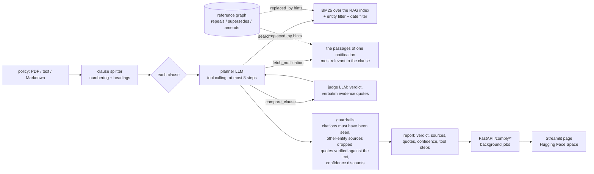
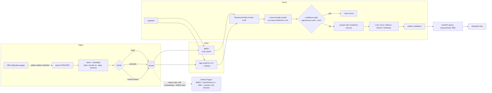

# rbi-circulars-rag

Two systems over 2,900 Reserve Bank of India (RBI) notifications, each with its own
evaluation:

1. **[A compliance agent](#compliance-agent)** that reads a bank's internal policy
   document, checks it clause by clause against RBI regulations, and reports for each
   clause a verdict (**conflict**, **gap**, **compliant**, **not applicable** or
   **insufficient evidence**), the notifications relied on, verified evidence quotes and
   a confidence. It says "insufficient evidence" rather than guess.
2. **[A hybrid-retrieval RAG](#retrieval-augmented-qa-the-agents-search-tool)** (BM25 +
   bge-small in Qdrant, RRF fusion, cross-encoder reranking) that answers questions with
   numbered citations and says "I don't know" when retrieval confidence is low. The
   agent uses its retrieval stack as a tool.

Everything runs on free tiers: GitHub Actions on a public repository, Gemini and Groq
free API tiers, local Ollama, a free Hugging Face CPU Space and GitHub Pages. Every
number below comes from a recorded run (date, commit, model); nothing is typed in by
hand.

- **Policy-check demo (Hugging Face Space):** built and smoke-tested by `space.yml`;
  live once a free Hugging Face token is configured (see [Deploy](#deploy-the-demo-free)).
- **Browser search demo:** https://srini2k03.github.io/rbi-circulars-rag/ (`pages.yml`)
- **Everything locally:** `docker compose up` (see [Run it](#run-it-1)).

# Compliance agent

## What it does

Five real outputs of the agent (dev split, `gemini-3.5-flash-lite`, recorded in
`results/compliance/predictions/agent-dev-gemini.jsonl`, commit `6d6c54e`), one per
verdict, all matching the labels:

| policy clause (excerpt) | verdict | evidence quote the verdict rests on (verified in the notification) |
|---|---|---|
| "KYC records of new customers shall be uploaded to the Central KYC Records Registry within 30 days ..." | **conflict**, rbi-13141 | "the bank shall capture customer's KYC records and upload onto CKYCR within 10 days of commencement of an account-based relationship" |
| "the Bank shall send the customer at least three advance intimations through the available communication channels" | **gap**, rbi-13141 | "at least three advance intimations, including at least one intimation by letter" |
| "Periodic updation of KYC ... at least once every two years for high-risk customers, once every eight years for medium-risk ..." | **compliant**, rbi-13141 | "periodic updation at least once in every two years for high-risk customers, once in every eight years for medium risk customers ..." |
| "All customers shall be screened against adverse media sources at onboarding and at least once a year" | **insufficient evidence** | none: no notification in the corpus governs adverse-media screening |
| "The Compliance Department shall hold its weekly coordination meeting every Monday at 10 a.m." | **not applicable** | none: an internal matter no RBI regulation governs |

Input: a policy as PDF, text or Markdown. The clause splitter follows the policy's own
numbering (1., 1.1, (a) ...) and headings, keeps sub-items with their parent clause and
handles text extracted from PDFs (segmentation P/R/F1 1.00 on the labelled policies, as
text and as rendered PDFs). Output: a Markdown or JSON report, through the CLI, the API
(`/comply/*`) or the Streamlit page.

The regulations are a snapshot of 2,903 RBI notifications up to 2026-11-11 (release
`corpus-v2`), including the November 2025 consolidated "Reserve Bank of India
(Commercial Banks - ...) Directions" and their 2026 amendments. Clauses are judged as of
that date, for a commercial bank.

## Architecture



How one clause is checked:

1. **Plan.** The planner sees the clause, its section and three tools. An internal
   matter (staff leave, office events) can be answered `not_applicable` straight away.
2. **Search.** `search_regulations` runs BM25 over the RAG's index and returns one hit
   per notification with its date, the entity it is addressed to and, from the reference
   graph, whether a later notification repeals or supersedes it. Directions addressed to
   other entity types (NBFCs, urban co-operative banks, ...) are filtered out: their
   wording is often identical, and they are the wrong authority for a commercial bank.
3. **Read.** `fetch_notification` returns the passages of one notification most
   relevant to the clause, within a token budget (some Directions exceed 100K
   characters).
4. **Compare.** `compare_clause` sends the clause and the passages of up to four
   notifications to a separate judge call, which returns a verdict, citations, verbatim
   evidence quotes and a confidence. If the planner answers without comparing, the agent
   compares for it and adopts the judge's verdict.
5. **Guard.** A substantive verdict (compliant, conflict, gap) must rest on a comparison,
   cite only notifications a tool actually showed, not cite another entity's Directions,
   and carry at least one quote that is found (fuzzy-matched) in the passages read.
   Otherwise it becomes `insufficient_evidence`. Confidence is discounted for dropped
   citations, replaced sources and unverified quotes.

The **baseline** (`--system baseline`) is the fixed pipeline: search with the clause
text, compare against the top three hits, same guardrails. The evaluation measures what
the agent's own planning adds.

## Results

<!-- COMPLIANCE:START (generated by `rbirag comply eval readme`) -->
**Labelled set:** 89 synthetic policy clauses in 7 policies (26 dev / 63 test, split by policy), written by an AI from real notifications with every evidence quote machine-checked against the corpus; **0 human-verified**. Cost of every run: $0 (free tiers).

**Test split (locked, n = 63): in progress** (agent 39/63, baseline 1/63 clauses). The run resumes each day within the free-tier quota with the code frozen; its numbers replace this note when every test clause has a prediction. Until then the dev numbers below are the only results, and they were used for iteration.

**Dev split (n = 26; used to iterate on prompts and to choose the abstention threshold):** agent: `gemini-3.5-flash-lite` via gemini, commit `6d6c54e`, 2026-11-21; baseline: `gemini-3.5-flash-lite` via gemini, commit `6d6c54e`, 2026-11-21. 95% bootstrap CIs.

| metric | agent | fixed pipeline (baseline) |
|---|---|---|
| verdict accuracy | 0.923 [0.808, 1.000] | 0.885 [0.731, 1.000] |
| macro-F1 | 0.944 [0.840, 1.000] | 0.918 [0.760, 1.000] |
| citation precision | 0.909 [0.773, 1.000] | 0.875 [0.760, 1.000] |
| citation recall | 0.864 [0.682, 1.000] | 0.909 [0.773, 1.000] |
| tool-argument validity | 1.000 [1.000, 1.000] | 1.000 [1.000, 1.000] |
| tool-selection accuracy | 1.000 [1.000, 1.000] | 0.269 [0.115, 0.462] |
| task success | 0.808 [0.654, 0.962] | 0.808 [0.654, 0.962] |
| calibration error (ECE, lower is better) | 0.067 [0.006, 0.183] | 0.150 [0.042, 0.304] |
| tool steps / clause | 3.7 [3.2, 4.2] | 2.0 [2.0, 2.0] |
| LLM calls / clause | 5.6 [5.0, 6.1] | 1.0 [1.0, 1.0] |
| tokens / clause | 16837 [14799, 18841] | 3560 [3469, 3650] |
| latency s / clause | 39.3 [34.8, 43.0] | 11.5 [10.7, 12.0] |

Agent minus baseline on dev (paired bootstrap):

| metric (n=26) | agent | baseline | agent - baseline [95% CI] |
|---|---|---|---|
| verdict accuracy | 0.923 | 0.885 | +0.038 [-0.077, +0.192] |
| task success | 0.808 | 0.808 | +0.000 [-0.192, +0.231] |
| citation recall | 0.864 | 0.909 | -0.045 [-0.273, +0.136] |

Failures by type (dev split; each failing clause counted once, under its most important failure):

| failure type | meaning | agent | baseline |
|---|---|---|---|
| `missed_issue` | called a conflict or gap compliant | 0 | 1 |
| `false_alarm` | called a compliant clause a conflict or gap | 1 | 1 |
| `conflict_gap_confusion` | conflict and gap swapped | 1 | 1 |
| `citation_miss` | right verdict, a required notification not cited | 3 | 2 |
| **clauses without a failure** | | 21 | 21 |

| retrieval (clause text as the query) | dev R@5 | dev MRR | test R@5 | test MRR | p50 ms |
|---|---|---|---|---|---|
| BM25, no entity filter | 0.50 | 0.29 | 0.62 | 0.35 | 78 |
| **BM25 + entity filter (used)** | 1.00 | 0.58 | 0.92 | 0.70 | 76 |
| hybrid (BM25 + bge-small, RRF) + filter | 0.95 | 0.68 | 0.91 | 0.68 | 129 |
| hybrid + cross-encoder rerank + filter | 1.00 | 0.63 | 0.92 | 0.61 | 7,347 |
| section chunks, BM25 + filter | 0.95 | 0.48 | 0.81 | 0.65 | 308 |

Full reports: [`results/compliance/`](results/compliance/) (`results-dev.md`, `results-test.md`, predictions with every tool call, run records).
<!-- COMPLIANCE:END -->

What the metrics mean (definitions in `src/rbirag/compliance/evaluation/metrics.py`):

- **Verdict accuracy / macro-F1** over the five verdicts (F1 averaged over the verdicts
  present in the split).
- **Citation precision:** cited notifications that are gold or explicitly acceptable.
  **Citation recall:** gold citation groups hit (a group is "any of these", e.g. a
  Direction or the amendment that inserted the rule). Non-substantive verdicts cite
  nothing.
- **Tool-argument validity:** tool calls whose arguments pass the schema. **Tool-selection
  accuracy:** clauses where the system called the tools the label expects (for example,
  `compare_clause` before a substantive verdict, no tools for an internal matter).
- **Task success:** verdict right *and* every gold citation group hit *and* no run error.
- **ECE:** expected calibration error of the confidence against correctness.
- Cost, tokens and latency are per clause and per document (policy); latency is the sum
  of recorded LLM and tool time, so live and replayed runs report the same numbers.

## Failure analysis

Grouped by the failure types in the table above (each failing clause is counted once,
under its most important failure). This analysis covers the **dev split**; it will be
extended with the locked test run when that completes.

- **Judgement errors by a small model** (`false_alarm`, `conflict_gap_confusion`,
  `missed_issue`). A clause that is *stricter* than the rule (prior consent for a renewed
  card, where the rule only requires an option to decline) was called a conflict, though
  the prompt defines stricter clauses as compliant; a penalty counted per *working* day
  instead of per *calendar* day was read as a gap instead of a conflict; the baseline
  missed that a risk-categorisation review "at the time of periodic updation" falls short
  of a six-monthly review. These are reasoning errors of a lite free-tier model on
  wording that differs in one word.
- **Right verdict, outdated citation** (`citation_miss`). The 28 November 2025
  consolidation withdrew thousands of earlier circulars, but the withdrawal list is in
  annexes the corpus does not contain, so nothing in the text marks a 2016 Master
  Direction or a 2021 circular as withdrawn. Both systems sometimes cite the old
  instrument, whose rule is unchanged. The source rules now state the consolidation,
  which fixed one case on dev and not two others.
- **Amendment vs amended Direction** (`citation_miss`). The agent cited the 2026
  amendment that inserted a timing rule, where the label requires the consolidated
  Directions and lists the amendment only as acceptable. Defensible; the label was not
  changed after seeing the output.
- **Engineering failures found on dev and fixed** (not in the table, which shows the
  final runs): the planner skipping `compare_clause` (13/26 clauses forced to
  `insufficient_evidence` by the guardrail on Groq), requests growing past a free tier's
  size limit (HTTP 413), Gemini rejecting tool calls without their thought signature,
  and a fallback chain silently answering with a different model. See the iteration log
  in [`docs/compliance_agent.md`](docs/compliance_agent.md#dev-iteration-log-dev-split-only-test-untouched-until-frozen).

## Design decisions

- **A plain tool-calling loop, not LangGraph.** Per clause the agent takes at most eight
  steps over three tools with one exit (the final answer). A hand-written loop of ~100
  lines keeps the full trajectory for the tool-call metrics, reuses the repository's
  rate limiter, model fallback chain and response cache (which make free tiers and
  exact CI replay workable), and has no graph state to serialise. LangGraph would pay
  off with branching multi-agent flows or human-in-the-loop checkpoints, neither of
  which this needs.
- **The judge is a separate call.** The planner decides what to read; `compare_clause`
  decides the verdict from passages only, with verbatim quotes that are verified against
  the text. The guardrails turn an unsupported verdict into `insufficient_evidence`
  instead of passing it on.
- **BM25 with an entity filter as the search tool.** Chosen on dev with the retrieval
  ablation above: the filter matters far more than dense retrieval or reranking, and
  BM25 is deterministic, needs no torch, and keeps replay exact.
- **A reference graph instead of withdrawal flags.** The corpus has no "withdrawn" flag,
  so citations between notifications (by circular number, reference number or Master
  Direction title) are extracted and labelled repeals / supersedes / amends / mentions
  from their wording. Hits carry `replaced_by` hints; 3,945 links, 93 notifications
  marked replaced.
- **Evaluation that can run on every push for free.** Live runs record every LLM
  response; CI replays all recorded runs from those responses with no provider call and
  fails on any changed prediction or any request that no longer matches (a prompt,
  tool or retrieval change).
- **A locked test split.** Prompts and the abstention threshold were tuned on 26 dev
  clauses from two policies; the 63 test clauses from five other policies are run once,
  with the code frozen.

## Run it

```bash
pip install -e ".[ingest,retrieval,llm,api,ui,eval,dev]"
gh release download corpus-v2 --pattern documents.jsonl.gz --dir data/processed  # or the GitHub release page
gunzip data/processed/documents.jsonl.gz
rbirag index --chunker fixed                         # BM25 index (~1 min, no torch)
export GEMINI_API_KEY=...                            # free key from aistudio.google.com (or GROQ_API_KEY)
rbirag comply clauses data/samples/kyc_policy_sample.md          # how the policy is split
rbirag comply check data/samples/kyc_policy_sample.md --backend gemini --out report.md
rbirag comply eval run --system agent --split dev --backend gemini   # evaluate
rbirag comply eval report --split dev                                 # tables with CIs
rbirag serve & streamlit run ui/streamlit_app.py     # API :8000 and UI :8501 ("Policy check" page)
```

Without a key, `--backend fake` runs an offline model that walks the same tool path and
always answers `insufficient_evidence`.

## Deploy the demo (free)

`docker/Dockerfile.space` is a one-container image (FastAPI + Streamlit on port 7860,
corpus and BM25 index baked in, no torch) for a free Hugging Face CPU Space.
`.github/workflows/space.yml` builds it, starts it and checks the API, a compliance
check and the UI on every relevant push. To deploy:

1. create a Hugging Face account and a write token;
2. add the repository secret `HF_TOKEN` and the repository variable `HF_SPACE`
   (e.g. `your-name/rbi-policy-check`);
3. push to the default branch or change `.github/space-deploy-request.json`.

The workflow creates the Space, copies `GEMINI_API_KEY` / `GROQ_API_KEY` into it as
Space secrets and uploads the app. The demo checks at most 15 clauses per run.

## Evaluation workflows

| Workflow | What it does |
|---|---|
| `compliance-ci.yml` | every push: ruff, mypy and the compliance tests; the labels checked against `corpus-v2` (every citation exists, every evidence quote is verbatim, clause segmentation); a replay of every recorded run with no provider call |
| `compliance-eval.yml` | live runs (agent and/or baseline, dev or test, Gemini or Groq free tier), started by pushing `.github/compliance-eval-request.json`; commits predictions, run records, reports, this README section and every LLM response; resumes after a quota stop |
| `compliance-retrieval.yml` | the retrieval ablation with real embeddings (BM25, hybrid, hybrid + rerank; with and without the entity filter) |
| `space.yml` | builds and smoke-tests the demo image; deploys it when configured |
| `corpus.yml` | crawls RBI notifications and publishes the corpus releases (`corpus-v2`: 2,903 notifications) |

## Limitations

- **Synthetic, AI-authored labels.** The 89 clauses and their verdicts were written by
  an AI from real notifications; every citation and evidence quote is machine-checked
  against the corpus in CI, but no label is human-verified yet
  (`rbirag comply eval review` is the review tool). The set is small: confidence
  intervals are wide, and dev (26 clauses) cannot separate the agent from the baseline.
- **Small free-tier models.** All reported runs use `gemini-3.5-flash-lite`. Most
  remaining errors are judgement errors on one-word differences that a stronger model
  would likely avoid; the free tier also limits a full test run to about one split per
  day.
- **Corpus snapshot without withdrawal flags.** The corpus stops at 2026-11-11, and the
  withdrawal lists of the November 2025 consolidation are in annexes it does not
  contain. The reference graph catches repeals stated in the text, not those.
- **Text-only policies.** No OCR for scanned PDFs; tables in policies are read as text.
- **One entity type.** Verdicts assume a commercial bank (`RBIRAG_COMPLIANCE_ENTITY`
  changes it, but the labelled set covers commercial banks only).
- **Not legal advice.** The agent shows its sources and quotes so a compliance officer
  can check every verdict; it does not replace that check.

# Retrieval-augmented QA (the agent's search tool)

Hybrid-retrieval RAG over the same RBI notifications. It answers with numbered citations
to the source notifications and says "I don't know" when retrieval confidence is low.
The evaluation (retrieval and generation metrics, ablations, bootstrap confidence
intervals) is the centrepiece.

- **Live demo (browser-only search, optional answers with your own key):**
  https://srini2k03.github.io/rbi-circulars-rag/ (published by `pages.yml`)
- **API + chat UI:** `docker compose up` (see [Run it](#run-it-1))

Every number in this part comes from a real run recorded in `results/run_metadata.json`
(date, commit, judge model, test-set label). Nothing is filled in by hand.

## Architecture



## Results

<!-- RESULTS:START (generated by `rbirag eval report --update-readme`) -->
**Test set: model-generated test set (`data/eval/qa_candidates.jsonl`): 216 model-generated pairs (43 AI-reviewed by Claude, 0 human-verified); 7 AI-rejected pairs excluded.** Generated 2026-11-05T18:46:17+00:00 at commit `050f1ee`.

**Judge: qwen2.5:7b-instruct, run locally with Ollama on CPU** (292 s per verdict on a CI runner); agreement with earlier judges: qwen/qwen3.8-27b n=23: faithfulness r=0.71, relevance weighted kappa=0.78; openai/gpt-oss-120b n=7: faithfulness r=-, relevance weighted kappa=0.00. NLI faithfulness and citation metrics are judge-independent.

**Split by document:** 155 test questions (130 documents) for every reported number; 61 dev questions (56 documents) used only to choose configurations and calibrate the gate. No document contributes questions to both.

Retrieval, top 5 of 36 configurations by chunk-level nDCG@10 (95% bootstrap CIs):

| config | chunks | doc R@5 | chunk R@1 | chunk R@5 | chunk R@10 | chunk MRR@10 | chunk nDCG@10 [95% CI] | p50 ms |
|---|---|---|---|---|---|---|---|---|
| fixed-512-bm25 | 10131 | 0.846 | 0.531 | 0.800 | 0.881 | 0.650 | 0.703 [0.643, 0.764] | 40.1 |
| fixed-1024-bm25 | 5618 | 0.846 | 0.527 | 0.785 | 0.885 | 0.639 | 0.697 [0.638, 0.763] | 22.4 |
| semantic-1024-bm25 | 12497 | 0.869 | 0.496 | 0.785 | 0.846 | 0.637 | 0.679 [0.622, 0.743] | 71.2 |
| semantic-512-bm25 | 15152 | 0.815 | 0.481 | 0.742 | 0.850 | 0.620 | 0.666 [0.609, 0.728] | 86.3 |
| section-1024-bm25 | 19369 | 0.831 | 0.458 | 0.746 | 0.827 | 0.610 | 0.654 [0.598, 0.717] | 118.8 |

Generation (rows marked complete: at least 90% of the planned questions answered and judged; `questions` is the sample each row was run on):

| config | backend (model) | questions | n | judge | faithfulness (judge) | faithfulness (NLI) | relevance (judge) | citation acc. (NLI) | citations valid | refusal P | refusal R | p50 ms | cost $ |
|---|---|---|---|---|---|---|---|---|---|---|---|---|---|
| fixed-1024-bm25 | ollama (qwen2.5:3b-instruct 100%) | full test set (n=155) | 155 | qwen2.5:7b-instruct | 0.953 [0.918, 0.984] | 0.212 [0.147, 0.280] | 0.941 [0.902, 0.975] | 0.170 [0.095, 0.264] | 0.438 | 0.913 [0.782, 1.000] | 0.840 [0.678, 0.966] | 245980 | 0.0000 |
| fixed-1024-bm25 | openai_compatible (openai/gpt-oss-20b 91%, qwen/qwen3.8-27b 5%, openai/gpt-oss-120b 3%) | fixed subset (n=60) | 60 | qwen2.5:7b-instruct | 0.986 [0.965, 1.000] | 0.131 [0.036, 0.238] | 0.977 [0.936, 1.000] | 0.185 [0.037, 0.333] | 0.488 | 0.615 [0.333, 0.875] | 0.800 [0.500, 1.000] | 57435 | 0.0000 |
| fixed-1024-hybrid | ollama (qwen2.5:3b-instruct 100%) | fixed subset (n=60) | 60 | qwen2.5:7b-instruct | 0.891 [0.783, 0.978] | 0.289 [0.167, 0.416] | 0.851 [0.745, 0.937] | 0.304 [0.130, 0.478] | 0.404 | 0.750 [0.499, 1.000] | 0.900 [0.667, 1.000] | 237035 | 0.0000 |
| fixed-1024-hybrid_rerank | ollama (qwen2.5:3b-instruct 100%) | fixed subset (n=60) | 60 | qwen2.5:7b-instruct | 0.918 [0.848, 0.978] | 0.290 [0.170, 0.402] | 0.897 [0.810, 0.968] | 0.185 [0.062, 0.333] | 0.478 | 0.714 [0.462, 0.929] | 1.000 [1.000, 1.000] | 237289 | 0.0000 |


Limitations:
- The test set is model-generated and AI-reviewed (by Claude); no pair is human-verified yet.
- The judge is a small local model (qwen2.5:7b-instruct), less reliable than a frontier judge. It was chosen because the free API tier's daily token limit allows only about 30 judge calls a day for these ~6K-token prompts; its agreement with the larger API judges on the answers both judged is reported.
- The openai_compatible backend was evaluated with the best configuration only, on a fixed 60-question subset (seeded, stratified by answerability), because the free tier's daily token quota allows only about 30 answers a day; its confidence intervals are wider than the full-test-set rows.

Full tables, charts and run metadata: [results/](results/README.md).
<!-- RESULTS:END -->

## What is in the box

- **Ingestion** (`rbirag fetch`, `rbirag ingest`):
  - a polite, resumable crawler (at least 1 s between requests, retries with backoff, a
    SHA-256 manifest, a `--probe` mode);
  - HTML/PDF parsing with defensive selector strategies;
  - cleaning and metadata: date, circular and reference numbers, department, addressee,
    sections.
- **Chunking:** fixed-size token windows, semantic (split on embedding-similarity drops)
  and section-aware (headings and numbered paragraphs).
- **Retrieval:** BM25 + dense (`BAAI/bge-small-en-v1.5` on Qdrant), RRF (k=60), a
  cross-encoder reranker, and a confidence score from the reranker.
- **Generation:**
  - numbered-source prompt with `[n]` citations;
  - citation validation (unknown ids, uncited sentences);
  - confidence gate;
  - streaming;
  - token and cost accounting.
- **API** (`rbirag serve`, FastAPI):
  - `/health`: index and model readiness;
  - `/ingest`: background job, polled at `/ingest/{job_id}`;
  - `/query`: answer, citations with title/date/circular no./RBI link, refusal reason,
    per-stage timings, tokens, cost;
  - `/query/stream`: server-sent events;
  - `/metrics`: per-stage latency, tokens and cost.

  Requests are logged as JSON with a request id, and Swagger is pre-filled with
  examples.
- **UI:** a Streamlit chat with streamed answers and clickable `[n]` citations that open
  the passage, its metadata and the RBI link. The sidebar sets mode, top-k, LLM backend
  and gate threshold.
- **Browser demo** (`web/`, `rbirag export-web`):
  - the same retrieval pipeline runs client-side over an int8-quantised index of the
    best configuration;
  - optional answers with a visitor-supplied Groq or Gemini key, which is sent only to
    that provider;
  - an evaluation dashboard.
- **Evaluation** (`rbirag eval ...`):
  - stratified Q/A generation plus unanswerable questions;
  - a terminal review tool;
  - Recall@k, MRR, nDCG at document and chunk level;
  - LLM-judge faithfulness (claim decomposition) and relevance;
  - DeBERTa NLI faithfulness and citation accuracy;
  - refusal precision and recall;
  - bootstrap CIs;
  - an ablation over 4 modes × 3 chunkers × 3 sizes;
  - gate calibration on a dev split;
  - CSV/Markdown/charts.

### Which models produce the numbers

Groq free tier (GPT-OSS 20B generator), local Ollama Qwen2.5-3B generator, and a local
Ollama Qwen2.5-7B judge for every answer of both generators.

| Role | Primary model | Fallbacks |
|---|---|---|
| API generator | `openai/gpt-oss-20b`, best config, fixed 60-question subset | `openai/gpt-oss-120b` |
| Judge (all reported numbers) | Ollama `qwen2.5:7b-instruct` on the CI runners (q4, CPU) | - |
| Q/A writer | `openai/gpt-oss-120b` | `qwen/qwen3.8-27b` |
| Local generator | Ollama `qwen2.5:3b-instruct`: best config on the full test set (155), two more configs on the subset (60) | - |

- **Why a local judge:** the free tier allows about 200K tokens per model per day, about
  30 judge calls for these ~6K-token prompts, so judging ~330 answers would take two
  weeks. The 7B judge runs on 16-20 parallel runners in one workflow run. The earlier
  verdicts from `openai/gpt-oss-120b` and `qwen/qwen3.8-27b` are kept, and the results
  report their agreement with the 7B judge (correlation, agreement %, Cohen's kappa).
- **Why a 60-question API subset:** the same quota limits the API generator to about 30
  answers a day. `qwen/qwen3.8-27b` cannot stand in: it rejects ~6K-token prompts (HTTP
  413).

- **Model mix:** every record stores the model that actually answered, and the results
  report the mix per role.
- **Q/A writers:** of the first 123 Q/A candidates, 4 were written by Gemini
  (`gemini-3.5-flash`) before the switch to Groq.
- **Judge-independent check:** NLI-based faithfulness and citation accuracy are reported
  next to the judge's scores, because a free-tier judge can be lenient.
- **Cost:** reported as **$0** (free tier); token counts are still recorded.

## Run it

### pip

```bash
pip install -e ".[ingest,retrieval,llm,eval,api,ui,dev]"  # light: no torch
make check                                               # ruff, mypy, pytest (offline)
make smoke                                               # offline end-to-end run on fixtures

pip install -e ".[ml]"                                   # real embedder, reranker, NLI model
export GROQ_API_KEY=...                                  # free key from console.groq.com
rbirag fetch --max-docs 2200 && rbirag ingest            # or download the corpus-v1 release
rbirag index --chunker section
rbirag query "What is the KYC updation period for high risk customers?"
rbirag serve                                             # API on :8000 (Swagger at /docs)
streamlit run ui/streamlit_app.py                        # chat UI on :8501
```

### Docker Compose

```bash
cp .env.example .env            # add GROQ_API_KEY
docker compose up -d --build    # api :8000, ui :8501, qdrant :6333
curl -X POST localhost:8000/ingest -H 'content-type: application/json' \
  -d '{"documents_path": "/data/processed/documents.jsonl"}'   # or {"urls": [...]}
docker compose --profile ollama up -d   # adds Ollama and pulls qwen2.5:3b-instruct once
```

To try the stack without any key or corpus:

```bash
docker compose -f docker-compose.yml -f docker/compose.smoke.yml up -d --build
```

This is what CI runs: the fake LLM, fake models and a fixture index.

### Static site locally

```bash
rbirag export-web --out web/data/index      # needs the [ml] extra for real embeddings
python -m http.server -d web 8080           # open http://localhost:8080
```

## Design decisions and trade-offs

- **RRF instead of score fusion.**
  - BM25 scores are unbounded and corpus-dependent; cosine scores live in a narrow band
    that shifts with the embedder.
  - Adding them needs per-query normalisation and a tuned weight that drifts as the
    corpus grows.
  - Reciprocal Rank Fusion uses ranks only, has one robust constant (k=60) and is
    trivially reproducible in the browser.
  - The ablation reports both arms alone, so the gain (or the lack of it) is measured.
- **Three chunkers.**
  - Fixed windows are the baseline.
  - Semantic chunking follows topic shifts but costs an embedding pass per sentence.
  - Section-aware chunking follows RBI's numbered paragraphs and headings, which is how
    circulars are cited ("para 2.1").
  - Gold evidence is stored as character spans, so all three are scored fairly at chunk
    level as well as document level.
- **Confidence gate.**
  - The probability is the sigmoid of the top cross-encoder logit.
  - The threshold τ is chosen on a dev split by maximising F0.5 of refusals: refusing an
    answerable question is treated as worse than letting the LLM see weak context
    (it may still refuse).
  - The split is by document (seeded): all questions about one notification are in the
    same split. The generation configuration and τ are chosen on dev only; every
    reported number is on test, and the results state both split sizes.
  - The calibration curve is in `results/charts/calibration.png`.
- **A small embedder everywhere.**
  - `bge-small-en-v1.5` (384-d) and `ms-marco-MiniLM-L-6-v2` run on CPU in CI and have
    ONNX ports for transformers.js.
  - The browser demo therefore uses the same models as the API.
  - The cost is some recall versus larger embedders; the ablation shows how much BM25
    and the reranker recover.
- **Qdrant rather than Chroma.**
  - One client API covers embedded in-memory/on-disk mode (tests, CI) and a server
    (Docker), with payload filtering for later metadata filters (year, department).
  - Chroma would have worked; Qdrant's embedded mode made the no-network test suite and
    the compose stack share code paths.
- **Free-tier LLMs, as actually experienced.**
  - **Gemini:**
    - `gemini-2.5-flash` returned 404 for a new key.
    - `gemini-3.8-flash` and `3.7-flash` hit the daily quota after a few requests.
    - `gemini-3.5-flash` returned 503 "overloaded" on almost every call. One run
      produced 4 Q/A pairs.
  - **Groq:**
    - Llama 3.3 70B and Llama 3.1 8B were not available to the key (404).
    - `openai/gpt-oss-120b` wrote 119 pairs in one run.
    - JSON mode occasionally rejects a generation (`json_validate_failed`), so those
      items are retried without JSON mode and then skipped.
    - Two repositories sharing one key hit 429s together.
  - **How the code copes:** model fallback chains, per-model RPM/RPD/TPM budgets, a
    cache of successful calls only, resumable daily workflows, and guards that never
    present a mostly-failed configuration as a result.
- **Honest test-set labelling.**
  - Every result states whether the questions are model-generated, AI-reviewed or
    human-verified, with counts.
  - See [Test set status](#test-set-status).

## Test set status

**Test set: model-generated pairs, 50 of them AI-reviewed by Claude, 0 human-verified.**

- `data/eval/qa_candidates.jsonl`: the model-generated pairs. A daily workflow adds pairs
  until there are 220 answerable and 30 unanswerable ones.
- `data/eval/qa_ai_reviewed.jsonl`: an **AI review, not a human verification**. An AI
  assistant (Claude) checked 50 answerable pairs, a seeded sample stratified by year,
  department and question type, against the full source documents:
  - 20 accepted;
  - 23 edited (question/answer wording only);
  - 7 rejected.

  No unanswerable pairs existed yet to review. [`docs/qa_review.md`](docs/qa_review.md)
  gives the method, seed, counts and failure patterns. The file is append-only and keyed
  by `qa_id`, so pairs generated later stay unreviewed and do not disturb it.
- Evaluation applies the review:
  - AI-rejected pairs are excluded and AI-edited wording is used;
  - human decisions (`qa_v1.jsonl`, below) take precedence;
  - the AI review never sets `verified`.
- The results README states the test set, for example "81 model-generated pairs
  (43 AI-reviewed by Claude, 0 human-verified); 7 AI-rejected pairs excluded". It reports
  headline metrics on the full set and the same metrics on the AI-reviewed subset as a
  separate section.

## Reviewing the test set (about 30–40 minutes, on your own machine)

The `qa.yml` workflow writes model-generated candidates to `data/eval/qa_candidates.jsonl`.
Reviewing them by hand is what makes the test set "human-verified"; the README will state
exactly how many pairs were reviewed.

```bash
git clone https://github.com/srini2k03/rbi-circulars-rag && cd rbi-circulars-rag
python -m venv .venv && source .venv/bin/activate     # Windows: .venv\Scripts\activate
pip install -e .                                      # the review tool needs no extras
rbirag eval verify --limit 50                         # review 50 random pairs
```

For each pair you see the source passage (with the evidence highlighted), the question
and the reference answer. Press:

- **a** to accept;
- **e** to edit the question and/or answer (press Enter to keep a field as it is);
- **r** to reject, with an optional reason;
- **s** to skip;
- **q** to quit.

Every decision is saved immediately to `data/eval/qa_v1.jsonl`. Run the command again to
continue where you stopped. When you are done:

```bash
git add data/eval/qa_v1.jsonl
git commit -m "Review Q/A pairs"
git push
```

`verified: true` marks pairs a human accepted or edited; the AI review never sets it.
Rejected pairs (by a human, or by the AI review) are excluded from evaluation, as are
pairs that failed the automatic checks. Unreviewed pairs are still used and are reported
as model-generated.

## Workflows

| Workflow | What it does |
|---|---|
| `ci.yml` | ruff, mypy, pytest (Python 3.11/3.12, no network, no torch), the fixture smoke run, the static site (Node parity + Playwright with a mocked LLM), and a Docker Compose smoke test (fake LLM, fixture index) |
| `corpus.yml` | Crawls RBI and publishes the processed corpus as release `corpus-v1` |
| `qa.yml` | Generates Q/A candidates with the API provider (Groq by default) and commits `data/eval/qa_candidates.jsonl` |
| `evaluate.yml` | Runs the retrieval ablation, gate calibration, generation (API provider and Ollama), judging and the report, then commits `results/` and refreshes the results section above |
| `pages.yml` | Exports the browser index from the real corpus, renders the site in Chromium against it, then publishes `web/` + `results/` to GitHub Pages |

`qa.yml` and `evaluate.yml` take a `provider` input (`groq` or `gemini`). They need the matching repository
secret (`GROQ_API_KEY` or `GEMINI_API_KEY`), fail early (without printing it) if it is
missing, and list the models the key can use. Each provider has its own concurrency
group, so runs on the same provider never compete for its quota.

Both also run on a daily schedule, to use each day's free-tier token allowance (scheduled
runs use the input defaults):
- `qa.yml` at 09:41 UTC. It stops early, successfully and without a commit, once the
  candidate set has reached its targets (220 answerable + 30 unanswerable, allowing a 5%
  shortfall for items the model keeps failing).
- `evaluate.yml` every 6 hours at :41, as a fallback: one dispatch runs the whole
  evaluation, and the schedule only resumes what a run left (e.g. API answers past the
  daily quota). It is a no-op once every planned answer has a verdict from the
  configured judge. Every job checks out the latest `main`, so a queued run continues
  from what earlier runs committed, and committed retrieval results are reused
  (`force_retrieval` re-runs them).

How one `evaluate.yml` run is laid out (each stage's jobs run in parallel):
1. `select` plans the generation (the API backend: best config on the fixed subset).
2. `embed` embeds the corpus once for the dense configs (cached; other jobs download the
   vectors); `generate-api` and the `generate-ollama` shards answer what is missing.
3. `judge-ollama` (`judge_shards`, default 16) and `judge-api` (`api_judge_shards`,
   default 4) judge every answer without a verdict from the local judge, split by a
   stable hash of the question id. Each job logs its seconds per verdict.
4. `report` merges everything onto the latest `main` and publishes.

How `evaluate.yml` avoids losing work:
- generate and judge jobs stop cleanly before `budget_minutes` (default 300, job timeout
  330), flush their records and upload them even when a step fails; the next run
  resumes from them;
- every record keeps each judge's verdict, so changing the judge re-judges answers
  without losing the earlier verdicts;
- `scripts/publish_results.sh` fetches the latest `main`, union-merges this run's records
  into the committed ones (per question, a judged answer beats an unjudged one, which
  beats an error; otherwise the newer wins), regenerates the tables, charts and README
  section from the merged records, and repeats the whole loop if the push is rejected.
  Derived files are never rebased as text.

Until you have reviewed pairs with `rbirag eval verify`, evaluation runs on the
model-generated candidates, and the results README says so in its first line
("model-generated test set ...: N model-generated pairs (K AI-reviewed by Claude,
0 human-verified)"). Once `data/eval/qa_v1.jsonl` exists it is used instead, and the line
names it with its human-verified count. In both cases the AI review in
`data/eval/qa_ai_reviewed.jsonl` is applied on top.

Run LLM workflows that use the same API key one at a time, including workflows in
*other* repositories that share the key: free-tier limits are per key (or per
organisation), so concurrent runs hit 429s together and slow each other down.

Both stop cleanly when the daily free-tier quota runs out: rerun them later and they continue from the committed records and the cached
LLM responses. `evaluate.yml` prints the planned number of LLM calls before generating.

Guards against misleading output:
- an unknown model or rejected key (404/401/403 on every model in the chain) aborts the
  run with a clear message, and nothing from that run is committed;
- a run that produced no successful items commits nothing;
- a configuration whose generation or judge calls mostly failed (fewer than 90% of the
  planned questions succeeded) is shown as "incomplete (k/N)" and kept out of the
  headline tables.

## Limitations and future work

- **Model-generated questions.** The questions are written by an LLM from sampled
  passages, which favours questions that are easy to retrieve lexically. Human review,
  plus questions written from real compliance queries, would make the set harder and
  fairer.
- **Small models.** The judge is a local 7B model and the generators are small
  free-tier or local models; a stronger judge (or a paid tier) would tighten the
  faithfulness numbers. The NLI cross-check and the judge-agreement table are there
  because of this. The API generator is measured on a 60-question subset only (free-tier
  quota), so its confidence intervals are wider.
- **Browser demo coverage.** The demo index is capped at about 25 MB; if the corpus does
  not fit, it covers recent years only and says so on the page.
- **Text-only ingestion.** No OCR for scanned PDFs, and tables are flattened to text.
- **Static corpus.** The corpus is a snapshot (release `corpus-v1`). Incremental crawling
  plus `/ingest` would keep it current, and superseded circulars could be marked from
  RBI's "withdrawn" notices.
- **Future work:**
  - metadata filters (year, department) in retrieval and in the UI;
  - query rewriting for very short questions;
  - per-question cost and latency budgets in the API.

# License

MIT, see [LICENSE](LICENSE).
