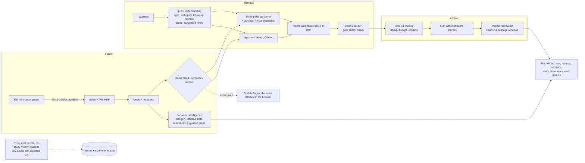
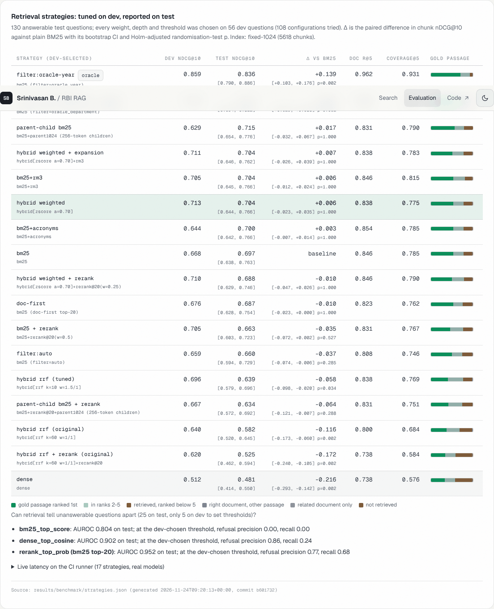
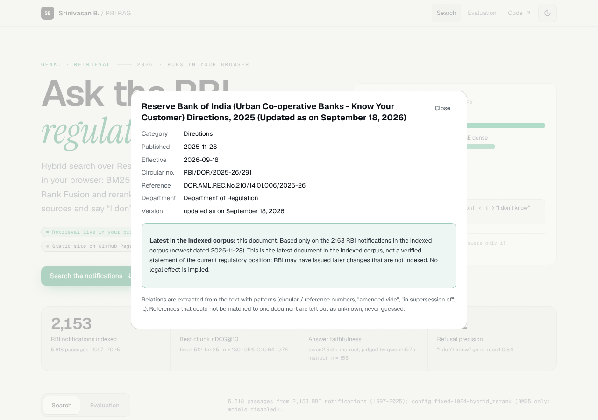
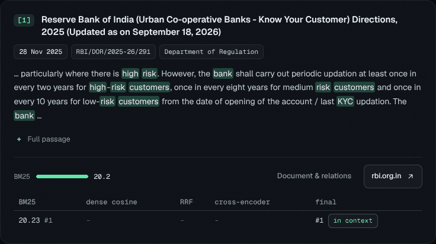

# rbi-circulars-rag

Retrieval-augmented question answering over 2,153 Reserve Bank of India notifications
(1997-2025), built and measured as a retrieval and evaluation project rather than "an LLM
on top of a vector database". Answers cite numbered passages; every citation is checked
against the passage it points to; questions the corpus cannot answer are refused; and every
number in this README comes from a committed run (file, date, commit, CI run id) logged in
[`results/experiments.jsonl`](results/experiments.jsonl).

- **Live demo (search runs in your browser):** https://srini2k03.github.io/rbi-circulars-rag/ :
  the served retrieval profile runs in the browser (BM25 ranking, cross-encoder gate; dense
  retrieval and fusion in hybrid modes), with an advanced view of every stage score, a document and relations panel, claim-level citation checks of the answers, and the
  evaluation dashboard. Answers need your own Groq or Gemini key (sent only to that provider).
- **API:** FastAPI, versioned under `/v1` ([docs/api.md](docs/api.md)); `docker compose up`.
- **Retrieval benchmark:** [docs/benchmark.md](docs/benchmark.md).

Highlights (test split; the questions are model-generated and AI-reviewed, not human-verified):

- 17 retrieval strategy families (108 configurations) tuned on dev and compared on the same
  130 held-out answerable questions with paired tests: **no deployable strategy beats plain BM25 significantly**
  (chunk nDCG@10 0.697; the best on dev, z-score weighted fusion, 0.704, Δ +0.006, CI
  [-0.023, +0.035]); the original equal-weight RRF hybrid was **0.116 worse** than BM25 and
  RRF + cross-encoder **0.172 worse** (Holm p = 0.002), which weighted fusion fixes.
- The cross-encoder is a poor reranker here but the **best abstention signal: AUROC 0.952** on
  the 25 unanswerable test questions (BM25 score 0.804), so the served default ranks with BM25
  and uses the cross-encoder only as the "I don't know" gate.
- The judge-vs-NLI faithfulness gap (0.95 vs 0.21) is mostly a protocol artefact: 86% of the
  passages exceed the NLI model's 512-token input, and checking claims against 3-sentence windows
  raises NLI faithfulness to **0.70-0.73** on the same 195 answers.
- Regulatory relation graph from the corpus text: 9,183 references, 2,671 resolved to an
  indexed notification, the rest left **unknown**; precision on a stratified sample
  **49/52** (AI-checked, not human-verified).

## Architecture



The served defaults are the profile the benchmark supports: fixed 1,024-token passages, BM25
ranking, the cross-encoder over the BM25 top 20 as the abstention gate (threshold 0.49, chosen
on dev), lexical citation verification. Every knob is a `RetrievalParams` field settable with an
`RBIRAG_*` variable or per request.

## Results

The generation numbers below come from `evaluate.yml` (generated block, unchanged since run
42083001224). They were measured with the pipeline as it was then: the `fixed-1024-bm25` rows
have **no confidence gate** (the gate needs a cross-encoder), so their refusal precision and
recall are the model's own refusals, not the gate's.

<!-- RESULTS:START (generated by `rbirag eval report --update-readme`) -->
**Test set: model-generated test set (`data/eval/qa_candidates.jsonl`): 216 model-generated pairs (43 AI-reviewed (LLM-assisted), 0 human-verified); 7 AI-rejected pairs excluded.** Generated 2026-11-05T18:46:17+00:00 at commit `050f1ee`.

**Judge: qwen2.5:7b-instruct, run locally with Ollama on CPU** (292 s per verdict on a CI runner); agreement with earlier judges: qwen/qwen3.8-27b n=23: faithfulness r=0.71, relevance weighted kappa=0.78; openai/gpt-oss-120b n=7: faithfulness r=-, relevance weighted kappa=0.00. NLI faithfulness and citation metrics are judge-independent.

**Split by document:** 155 test questions (130 documents) for every reported number; 61 dev questions (56 documents) used only to choose configurations and calibrate the gate. No document contributes questions to both.

Retrieval, top 5 of 36 configurations by chunk-level nDCG@10 (95% bootstrap CIs):

| config | chunks | doc R@5 | chunk R@1 | chunk R@5 | chunk R@10 | chunk MRR@10 | chunk nDCG@10 [95% CI] | p50 ms |
|---|---|---|---|---|---|---|---|---|
| fixed-512-bm25 | 10131 | 0.846 | 0.531 | 0.800 | 0.881 | 0.650 | 0.703 [0.643, 0.764] | 40.1 |
| fixed-1024-bm25 | 5618 | 0.846 | 0.527 | 0.785 | 0.885 | 0.639 | 0.697 [0.638, 0.763] | 22.4 |
| semantic-1024-bm25 | 12497 | 0.869 | 0.496 | 0.785 | 0.846 | 0.637 | 0.679 [0.622, 0.743] | 71.2 |
| semantic-512-bm25 | 15152 | 0.815 | 0.481 | 0.742 | 0.850 | 0.620 | 0.666 [0.609, 0.728] | 86.3 |
| section-1024-bm25 | 19369 | 0.831 | 0.458 | 0.746 | 0.827 | 0.610 | 0.654 [0.598, 0.717] | 118.8 |

Generation (rows marked complete: at least 90% of the planned questions answered and judged; `questions` is the sample each row was run on):

| config | backend (model) | questions | n | judge | faithfulness (judge) | faithfulness (NLI) | relevance (judge) | citation acc. (NLI) | citations valid | refusal P | refusal R | p50 ms | cost $ |
|---|---|---|---|---|---|---|---|---|---|---|---|---|---|
| fixed-1024-bm25 | ollama (qwen2.5:3b-instruct 100%) | full test set (n=155) | 155 | qwen2.5:7b-instruct | 0.953 [0.918, 0.984] | 0.212 [0.147, 0.280] | 0.941 [0.902, 0.975] | 0.170 [0.095, 0.264] | 0.438 | 0.913 [0.782, 1.000] | 0.840 [0.678, 0.966] | 245980 | 0.0000 |
| fixed-1024-bm25 | openai_compatible (openai/gpt-oss-20b 91%, qwen/qwen3.8-27b 5%, openai/gpt-oss-120b 3%) | fixed subset (n=60) | 60 | qwen2.5:7b-instruct | 0.986 [0.965, 1.000] | 0.131 [0.036, 0.238] | 0.977 [0.936, 1.000] | 0.185 [0.037, 0.333] | 0.488 | 0.615 [0.333, 0.875] | 0.800 [0.500, 1.000] | 57435 | 0.0000 |
| fixed-1024-hybrid | ollama (qwen2.5:3b-instruct 100%) | fixed subset (n=60) | 60 | qwen2.5:7b-instruct | 0.891 [0.783, 0.978] | 0.289 [0.167, 0.416] | 0.851 [0.745, 0.937] | 0.304 [0.130, 0.478] | 0.404 | 0.750 [0.499, 1.000] | 0.900 [0.667, 1.000] | 237035 | 0.0000 |
| fixed-1024-hybrid_rerank | ollama (qwen2.5:3b-instruct 100%) | fixed subset (n=60) | 60 | qwen2.5:7b-instruct | 0.918 [0.848, 0.978] | 0.290 [0.170, 0.402] | 0.897 [0.810, 0.968] | 0.185 [0.062, 0.333] | 0.478 | 0.714 [0.462, 0.929] | 1.000 [1.000, 1.000] | 237289 | 0.0000 |


Limitations:
- The test set is model-generated and AI-reviewed (LLM-assisted); no pair is human-verified yet.
- The judge is a small local model (qwen2.5:7b-instruct), less reliable than a frontier judge. It was chosen because the free API tier's daily token limit allows only about 30 judge calls a day for these ~6K-token prompts; its agreement with the larger API judges on the answers both judged is reported.
- The openai_compatible backend was evaluated with the best configuration only, on a fixed 60-question subset (seeded, stratified by answerability), because the free tier's daily token quota allows only about 30 answers a day; its confidence intervals are wider than the full-test-set rows.

Full tables, charts and run metadata: [results/](results/README.md).
<!-- RESULTS:END -->

**Answer correctness without an LLM** (`results/analysis/answer_correctness.json`, run at
`2eb49e1`): against the reference answers of the answered test questions, token F1 is
0.577 [0.543, 0.612] for the local qwen2.5:3b answers (n = 128) and 0.531 [0.475, 0.585] for
the API model (n = 70); of the reference answers' figures (amounts, dates, percentages), the
answers state 84.7% (n = 76) and 92.8% (n = 38).

### Retrieval strategies (dev-tuned, reported on test)

Full report: [docs/benchmark.md](docs/benchmark.md). Run 45364004807, commit `b601732`, index
`fixed-1024` (5,618 passages), 130 answerable test questions, 56 dev questions.

| strategy (dev-selected) | test chunk nDCG@10 [95% CI] | Δ vs BM25 [95% CI] | Holm p | doc R@5 | live p50 ms |
|---|---|---|---|---|---|
| BM25 filtered to the gold document's year (oracle upper bound) | 0.836 [0.790, 0.886] | +0.139 [+0.103, +0.176] | 0.002 | 0.962 | 1.3 |
| parent-child (256-token children, 1,024-token windows) | 0.715 [0.654, 0.776] | +0.017 [-0.032, +0.067] | 1.000 | 0.831 | 13.2 |
| weighted fusion, z-score, BM25 0.7 / dense 0.3 (best on dev) | 0.704 [0.644, 0.766] | +0.006 [-0.023, +0.035] | 1.000 | 0.838 | 78.0 |
| BM25 + RM3 | 0.704 [0.645, 0.766] | +0.006 [-0.012, +0.024] | 1.000 | 0.846 | 8.8 |
| **BM25** | **0.697 [0.638, 0.763]** | - | - | 0.846 | 4.0 |
| BM25 + cross-encoder rerank | 0.663 [0.603, 0.723] | -0.035 [-0.072, +0.002] | 0.527 | 0.831 | 1,221 |
| filters detected in the question | 0.660 [0.594, 0.729] | -0.037 [-0.074, -0.006] | 0.285 | 0.808 | 3.9 |
| hybrid RRF k=60, equal weights (original) | 0.582 [0.520, 0.645] | -0.116 [-0.173, -0.060] | 0.002 | 0.800 | 81.0 |
| hybrid RRF + cross-encoder (original default) | 0.525 [0.462, 0.594] | -0.172 [-0.240, -0.105] | 0.002 | 0.738 | 1,352 |
| dense (bge-small) | 0.481 [0.414, 0.550] | -0.216 [-0.293, -0.142] | 0.002 | 0.738 | 73.2 |

Latency is from the live pass with the real models on a 4-vCPU CI runner. Most misses are
ranking, not recall: for BM25, 26 of 28 misses are passages a first-stage retriever finds but
ranks below the 5-passage context.




### Faithfulness: why the LLM judge and NLI disagree

The results table shows judge faithfulness 0.95 next to NLI faithfulness 0.21 for the same
answers. `rbirag eval nli-study` re-scored the 195 judged, non-refused answers of
`fixed-1024-bm25` (both generators) with the same NLI model (DeBERTa-v3-base) under four
protocols (CI run 45364819218, `results/analysis/nli_study.json`). The original protocol
reproduces the committed scores for 195/195 answers.

| NLI protocol | mean faithfulness [95% CI] | answers fully supported |
|---|---|---|
| each sentence vs the whole cited passage (original) | 0.190 [0.144, 0.247] | 16.4% |
| each sentence vs 3-sentence windows of the cited passages | 0.626 [0.567, 0.690] | 52.3% |
| each sentence vs windows of any retrieved passage | 0.728 [0.670, 0.786] | 63.1% |
| clause-level claims vs windows of any passage | 0.705 [0.649, 0.761] | 58.5% |
| LLM judge (qwen2.5:7b), for reference | 0.966 [0.941, 0.988] | - |

What the evidence says:

- **Truncation, mostly.** 86% of the passages (1,024-token chunks) exceed the NLI model's
  512-piece input. 215 of the 345 answer sentences are entailed by some window but not by the
  whole passage; for 135 of them (63%) the supporting window lies beyond the truncation point,
  so the original protocol never saw the evidence. The other 80 are dilution: the evidence was
  inside the input, but a long premise of mostly unrelated text kept the entailment probability
  below 0.5.
- **Citation errors.** 60% of answer sentences carry no valid citation (e.g. "[6.2.4]", a
  section number, instead of a source number). Allowing any retrieved passage instead of only the
  cited ones adds 0.10.
- **What remains is a real disagreement.** After fixing the protocol, NLI still rates 27-30% of
  claims unsupported where the judge rates almost everything faithful; the judge sits at the
  ceiling (so its per-answer correlation with any NLI protocol is near zero, r = 0.13). Only 1
  answer was a "the documents do not specify" non-answer, so that pattern does not explain the gap.
  Which side is right on those claims needs human labels (`rbirag eval review-answers`); neither
  score is ground truth.

The citation verifier therefore checks claims against windows, not whole passages.

### Citation verification

Every generated answer is checked claim by claim (`rbirag.generation.verify`): each `[n]`
must exist, each passage must belong to the document it is shown as, circular numbers the
answer mentions must appear in a source, each cited passage must support a claim that cites
it, and each claim (sentences split into clauses) must be supported by a short window of its
cited passages. Invalid citations are removed from the displayed answer (the evaluation still
records them); claims without support are listed; an answer with no supported claim says the
documents do not establish it (or is withheld, `verify_policy=abstain`). The default scorer is
lexical (every figure in the claim must appear in the window, most content words must match);
an NLI cross-encoder can be used instead.

On the 196 committed answers of the `fixed-1024-bm25` configuration (both generators), the
lexical verifier (run `9103f98`, `results/analysis/citation_verification-lexical.json`) finds
141 answers fully supported, 22 partially and 32 not supported; 16.6% of claims unsupported;
7 answers citing a passage that does not exist; and 34.6% of cited passages supporting none of
the claims that cite them. Of the 187 answers the LLM judge rated fully faithful, 135 pass. These
are checks of the answers, not ground truth. With the NLI cross-encoder (DeBERTa-v3, claims vs
windows, threshold 0.5; CI run 45371390490, `citation_verification-nli.json`): 114 supported,
42 partially, 39 not supported; 28.1% of claims unsupported; mean share of supported claims per
answer 0.705, where the original whole-passage NLI protocol reported 0.212 (local model) and
0.131 (API model) in the results table above.
`rbirag eval review-answers` collects human labels
and `rbirag eval review-agreement` reports each check's Cohen's kappa against them (no human
labels yet).

### Document intelligence

`rbirag intel build` extracts, per notification, the category (master direction, master
circular, directions, regulations, A.P. (DIR Series) circular, circular), circular / reference /
notification numbers, publication and effective date (with the sentence it came from), and
every reference in the body (circular numbers, reference numbers, A.P. (DIR Series) numbers,
Master Direction titles). The citing sentence types the relation: supersedes, partially
modifies, amends, "amended vide" footnotes of consolidated directions (reversed: the cited
circular changed this one), consolidates (rows of a master circular's list), refers to.

- 9,183 references in 2,153 documents; 2,671 resolve to exactly one indexed document; 6,230 point
  outside the corpus and 282 are ambiguous: both are kept as **unknown**, never guessed.
- 2,223 distinct relations (1,493 refers to, 620 consolidates, 89 amends, 19 supersedes,
  2 partially modifies); 59 version families of directions / master circulars.
- Precision on a seeded sample stratified by type (`results/intel/precision.json`), checked by an
  AI assistant against the sentences (LLM-assisted, **not human-verified**): relations 49/52
  correct in both target and type (Wilson 95% CI 0.84-0.98; population-weighted 0.94); effective
  dates 15/20. A first sample was used to fix error patterns before this one was drawn. Recall is
  not measured.
- Questions it answers: which documents amend or supersede a notification, its versions and the
  original, the **latest document in the indexed corpus** (always with a disclaimer that this is
  not the verified current regulatory position and implies no legal effect), related documents,
  and a sentence-level diff of two documents (`rbirag intel show|diff`, `GET /v1/documents/{id}`).

- Multi-document questions (`results/analysis/multi_doc.json`): 40 questions generated from
  high-confidence amends / supersedes relations ("Which notification amended X, and what did it
  change?", gold = both documents; template-generated, not human-written). BM25 puts both
  documents in the 5-passage context for 30% of them; adding the best passage of documents the
  graph links to the retrieved ones (6.6 passages on average) raises that to 65%. The questions
  come from the same graph, so this shows the benefit when a relation is known, not the graph's
  accuracy.



### Query understanding

`rbirag.query.understanding` normalises the question, classifies it (definition, numeric,
procedural, temporal, comparison, relation lookup, yes/no, factual), detects ambiguity and
multi-part questions, rewrites follow-ups against the previous question (the rewrite is
returned, never silent), flags questions about other regulators or unrelated topics, and
suggests metadata filters. Measured (`results/analysis/query_understanding.json`, run at
`d7404d3`):

- 12 of the 25 unanswerable test questions are refused as out of scope (they ask about SEBI,
  IRDAI, PFRDA, tax or company law); 1 of 130 answerable questions is wrongly flagged. The list of
  other regulators was written from domain knowledge, but after seeing a few unanswerable
  questions, so this gain may be optimistic.
- Follow-up rewriting, on 20 AI-authored two-turn conversations whose second turn is an
  elliptical version of a test question: BM25 doc R@5 0.60 as asked, **0.95 rewritten**, 0.85 for
  the full original question; chunk nDCG@10 0.42 / 0.68 / 0.78.
- AI-authored behavioural inputs: 14/20 out-of-scope, 15/15 ambiguous and 10/10 multi-part
  questions flagged. These are synthetic checks, not real-world validation.

### Reliability

Context assembly drops near-duplicate passages (consolidated directions repeat whole
paragraphs), keeps passages within a token budget, reports source diversity, and reports
conflicting evidence (the same sentence with different figures in two documents, or two
versions of one direction) instead of silently picking one. LLM calls retry with backoff and
fall back across models; the gate refuses on weak retrieval; out-of-scope and unanswerably
vague questions are refused before any LLM call.

## API

Versioned under `/v1`, documented in [docs/api.md](docs/api.md) and at `/docs`:
`POST /v1/ask`, `/v1/retrieve`, `/v1/retrieval/compare`, `/v1/citations/verify`,
`/v1/eval/run` (disabled unless `RBIRAG_API_EVAL_TOKEN` is set), `GET /v1/documents/{id}`,
`/v1/documents/{id}/relations`, `/v1/health`, `/v1/ready`, and `/metrics` (stage latency
percentiles, abstention and failed-retrieval rates, verification verdicts, errors by component).
Pydantic validation, per-client rate limiting, body-size limits, a per-answer time budget,
request ids in JSON logs (no question or answer text), and an LRU retrieval cache.

## The site

The static demo runs the same retrieval in the browser (int8 embeddings, transformers.js) and
adds: an **advanced** view with the BM25 score, dense cosine, RRF score and cross-encoder score
and rank of every passage, and which passages form the generator's context; a claim-level
citation check of browser-generated answers; the document and relations panel; recent questions
and answer ratings stored only in the browser (ratings export as JSONL); and the evaluation tab
with every result above, read from `results/` at page load.



## Run it

### pip

```bash
pip install -e ".[ingest,retrieval,llm,eval,api,ui,dev]"  # light: no torch
make check                                               # ruff, mypy, pytest (offline)
make smoke                                               # offline end-to-end run on fixtures

pip install -e ".[ml]"                                   # real embedder, reranker, NLI model
export GROQ_API_KEY=...                                  # free key from console.groq.com
gh release download corpus-v1 -p 'documents.jsonl.gz' && mkdir -p data/processed \
  && gunzip -c documents.jsonl.gz > data/processed/documents.jsonl   # or: rbirag fetch && rbirag ingest
rbirag index                                             # fixed 1,024-token passages (default)
rbirag intel build                                       # relation graph for /v1/documents
rbirag query "What is the KYC updation period for high risk customers?"
rbirag serve                                             # API on :8000 (Swagger at /docs)
streamlit run ui/streamlit_app.py                        # chat UI on :8501
```

Configuration is environment-driven (`RBIRAG_*`, see `.env.example` and
`src/rbirag/config.py`); secrets are read from the environment variable named in the settings
and never logged.

### Docker Compose

```bash
cp .env.example .env            # add GROQ_API_KEY
docker compose up -d --build    # api :8000, ui :8501, qdrant :6333
curl -X POST localhost:8000/ingest -H 'content-type: application/json' \
  -d '{"documents_path": "/data/processed/documents.jsonl"}'   # or {"urls": [...]}
docker compose --profile ollama up -d   # adds Ollama and pulls qwen2.5:3b-instruct once
```

To try the stack without any key or corpus (what CI runs: fake LLM, fake models, fixture index):

```bash
docker compose -f docker-compose.yml -f docker/compose.smoke.yml up -d --build
```

### Static site locally

```bash
rbirag export-web --out web/data/index      # needs the [ml] extra for real embeddings
python -m http.server -d web 8080           # open http://localhost:8080
```

## Reproduce the experiments

| experiment | command (locally) | workflow (with the models) | output |
|---|---|---|---|
| retrieval ablation, 36 configs | `rbirag eval retrieval` | `evaluate.yml` | `results/retrieval_ablation*.csv` |
| retrieval strategy benchmark | `rbirag eval bench --no-models` (replays the committed score cache) | `benchmark.yml` | `results/benchmark/` |
| generation + judge | `rbirag eval generate`, `rbirag eval report` | `evaluate.yml` | `results/generation/`, the block above |
| judge vs NLI study | `rbirag eval nli-study --nli fake` (smoke) | `analysis.yml` (`nli-study`) | `results/analysis/nli_study.json` |
| citation verification | `rbirag eval verify-citations` (lexical) | `analysis.yml` (`verify-citations`, NLI) | `results/analysis/citation_verification-*.json` |
| query understanding | `rbirag eval query-understanding` | - | `results/analysis/query_understanding.json` |
| relation extraction precision | `rbirag intel build`, `rbirag intel sample`, `rbirag intel precision` | - | `results/intel/` |
| human review of answers | `rbirag eval review-answers`, `rbirag eval review-agreement` | - | `data/eval/answer_reviews.jsonl` |

Every run appends a line to `results/experiments.jsonl` with the command, commit, whether the
tree had uncommitted changes, corpus and test-set hashes, configuration hashes and headline
numbers; CI runs add their run id. Seeds are fixed (`RBIRAG_SEED`, default 13).

## Tests

`make check` runs ruff, ruff format, mypy (strict) and pytest; 369 tests pass offline (no
network, no torch) with fake embedder / reranker / LLM, plus 4 Playwright tests of the static
site (run in CI's web job): retrieval (BM25 bit-identity with `rank_bm25`, fusion, expansion,
filters, parent windows, the benchmark and its replay), citation verification, query
understanding, context checks, relation extraction and the graph, the `/v1` API (validation,
rate limits, guarded evaluation, refusals), metrics, the JS/Python parity of the browser
retrieval, and the site (advanced view, document panel, citation check, feedback export).
CI also runs the fixture smoke run and a Docker Compose smoke test.

## Design decisions and trade-offs

- **BM25 as the ranker, the cross-encoder as the gate.** Chosen by the benchmark, not by taste:
  dense retrieval with a small CPU embedder (bge-small, 512-token input, so 1,024-token passages
  are truncated) is far weaker than BM25 on this corpus of formulaic regulatory text, and the
  MS MARCO cross-encoder reorders worse than BM25 - but its top score is the best signal of
  whether the corpus answers the question.
- **Weighted fusion next to RRF.** RRF is robust when both rankers are comparable; here they are
  not, and equal votes cost 0.116 nDCG@10. Per-query z-scores with a dev-tuned weight recover
  BM25-level quality; RRF stays available (`fusion=rrf`).
- **Expansion only where shown.** The acronym dictionary is mined from the corpus's own
  definitions ("Know Your Customer (KYC)"); RM3 follows Anserini. Neither helps significantly, so
  neither is on by default; both report the added terms with every result.
- **Filters are explicit.** Oracle filters show how much a known year or department helps
  (+0.139 / +0.054); filters guessed from the question text hurt (-0.037), so they are suggested,
  not applied.
- **Unknown over guessed.** A reference that does not resolve to exactly one document is kept as
  unknown with its candidates; "latest" always means latest in the indexed corpus.
- **Free-tier and local models.** The judge is a local 7B model, generators are small; see the
  models table. The judge-agreement table, NLI and the citation verifier exist because a small
  judge can be lenient.
- **Qdrant rather than Chroma.** One client API for embedded mode (tests, CI) and a server
  (Docker), with payload filtering, which the metadata filters now use.

## Which models produce the numbers

Groq free tier (GPT-OSS 20B generator), local Ollama Qwen2.5-3B generator, and a local
Ollama Qwen2.5-7B judge for every answer of both generators.

| Role | Primary model | Fallbacks |
|---|---|---|
| API generator | `openai/gpt-oss-20b`, best config, fixed 60-question subset | `openai/gpt-oss-120b` |
| Judge (all reported numbers) | Ollama `qwen2.5:7b-instruct` on the CI runners (q4, CPU) | - |
| Q/A writer | `openai/gpt-oss-120b` | `qwen/qwen3.8-27b` |
| Local generator | Ollama `qwen2.5:3b-instruct`: best config on the full test set (155), two more configs on the subset (60) | - |

- **Why a local judge:** the free tier allows about 200K tokens per model per day, about
  30 judge calls for these ~6K-token prompts, so judging ~330 answers would take two
  weeks. The 7B judge runs on 16-20 parallel runners in one workflow run. The earlier
  verdicts from `openai/gpt-oss-120b` and `qwen/qwen3.8-27b` are kept, and the results
  report their agreement with the 7B judge (correlation, agreement %, Cohen's kappa).
- **Why a 60-question API subset:** the same quota limits the API generator to about 30
  answers a day. `qwen/qwen3.8-27b` cannot stand in: it rejects ~6K-token prompts (HTTP
  413).

- **Model mix:** every record stores the model that actually answered, and the results
  report the mix per role.
- **Q/A writers:** of the first 123 Q/A candidates, 4 were written by Gemini
  (`gemini-3.5-flash`) before the switch to Groq.
- **Judge-independent check:** NLI-based faithfulness and citation accuracy are reported
  next to the judge's scores, because a free-tier judge can be lenient.
- **Cost:** reported as **$0** (free tier); token counts are still recorded.

## Test set status

**Test set: model-generated pairs, 50 of them AI-reviewed (LLM-assisted), 0 human-verified.**

- `data/eval/qa_candidates.jsonl`: the model-generated pairs. The `qa.yml` workflow added pairs
  until there were 220 answerable and 30 unanswerable ones.
- `data/eval/qa_ai_reviewed.jsonl`: an **AI review, not a human verification**. An AI
  assistant (an LLM) checked 50 answerable pairs, a seeded sample stratified by year,
  department and question type, against the full source documents:
  - 20 accepted;
  - 23 edited (question/answer wording only);
  - 7 rejected.

  No unanswerable pairs existed yet to review. [`docs/qa_review.md`](docs/qa_review.md)
  gives the method, seed, counts and failure patterns. The file is append-only and keyed
  by `qa_id`, so pairs generated later stay unreviewed and do not disturb it.
- Evaluation applies the review:
  - AI-rejected pairs are excluded and AI-edited wording is used;
  - human decisions (`qa_v1.jsonl`, below) take precedence;
  - the AI review never sets `verified`.
- The results README states the test set, for example "81 model-generated pairs
  (43 AI-reviewed (LLM-assisted), 0 human-verified); 7 AI-rejected pairs excluded". It reports
  headline metrics on the full set and the same metrics on the AI-reviewed subset as a
  separate section.

## Reviewing the test set (about 30–40 minutes, on your own machine)

The `qa.yml` workflow writes model-generated candidates to `data/eval/qa_candidates.jsonl`.
Reviewing them by hand is what makes the test set "human-verified"; the README will state
exactly how many pairs were reviewed.

```bash
git clone https://github.com/srini2k03/rbi-circulars-rag && cd rbi-circulars-rag
python -m venv .venv && source .venv/bin/activate     # Windows: .venv\Scripts\activate
pip install -e .                                      # the review tool needs no extras
rbirag eval verify --limit 50                         # review 50 random pairs
```

For each pair you see the source passage (with the evidence highlighted), the question
and the reference answer. Press:

- **a** to accept;
- **e** to edit the question and/or answer (press Enter to keep a field as it is);
- **r** to reject, with an optional reason;
- **s** to skip;
- **q** to quit.

Every decision is saved immediately to `data/eval/qa_v1.jsonl`. Run the command again to
continue where you stopped. When you are done:

```bash
git add data/eval/qa_v1.jsonl
git commit -m "Review Q/A pairs"
git push
```

`verified: true` marks pairs a human accepted or edited; the AI review never sets it.
Rejected pairs (by a human, or by the AI review) are excluded from evaluation, as are
pairs that failed the automatic checks. Unreviewed pairs are still used and are reported
as model-generated.

## Workflows

| Workflow | What it does |
|---|---|
| `ci.yml` | ruff, mypy, pytest (Python 3.11/3.12, no network, no torch), the fixture smoke run, the static site (Node parity + Playwright with a mocked LLM), and a Docker Compose smoke test (fake LLM, fixture index) |
| `pages.yml` | Exports the browser index and the relation graph from the real corpus, renders the site in Chromium against them (search, document panel, evaluation tab), then publishes `web/` + `results/` to GitHub Pages |
| `benchmark.yml` | The retrieval strategy benchmark with the real embedder and cross-encoder; verifies that the score-cache replay reproduces the run, then commits `results/benchmark` |
| `analysis.yml` | Model-dependent analyses of committed answers: the judge-vs-NLI study and NLI citation verification |
| `evaluate.yml` | Retrieval ablation, gate calibration, generation (API provider and Ollama), sharded local judging and the report; commits `results/` and refreshes the generated block above |
| `qa.yml` | Generates Q/A candidates with the API provider (Groq by default) and commits `data/eval/qa_candidates.jsonl` |
| `corpus.yml` | Crawls RBI and publishes the processed corpus as release `corpus-v1` |

All are dispatch-only except CI and Pages (push). Results come back as bot commits that rebase
onto the latest `main` and retry (`scripts/commit_outputs.sh`, `scripts/publish_results.sh`);
nothing is merged as text. LLM workflows that share a free-tier key must run one at a time.

## Project structure

```text
src/rbirag/
  ingest/        crawler, HTML/PDF parsing, cleaning, metadata
  chunking/      fixed, semantic and section-aware chunkers
  index/         BM25 (postings scorer), Qdrant dense index, embedders, chunk store
  retrieval/     RetrievalParams, Retriever, fusion, expansion (acronyms.json, RM3), parents, rerank, gate
  query/         query understanding and filter detection
  generation/    prompts, LLM backends (Groq/Gemini/Ollama/Anthropic), RAG pipeline,
                 context checks, citation parsing and verification
  intel/         document metadata, reference extraction, relation graph, review
  eval/          test set, metrics, ablation, benchmark, score cache, NLI study, human review,
                 judge, statistics, experiment log, reports
  api/           FastAPI app, /v1 router, schemas, service, rate limiter, metrics
web/             static site (browser retrieval, advanced view, document panel, dashboard)
ui/              Streamlit chat
data/eval/       Q/A candidates, AI review, AI-authored behavioural inputs
data/intel/      verdicts of the relation-extraction check
results/         every reported number (+ experiments.jsonl)
docs/            benchmark report, API, test-set review notes, images
```

## Limitations

- **Model-generated, AI-reviewed questions.** 216 pairs written by LLMs from sampled passages
  (favouring lexically retrievable questions), 43 accepted or edited by an AI review, none
  human-verified. Results may not transfer to real compliance questions. Dev has only 56
  answerable and 5 unanswerable questions, so dev-tuned thresholds (notably the gate) are fragile.
- **No strategy significantly better than BM25.** The benchmark's differences among the top
  strategies are within noise at n = 130.
- **Generation numbers predate the new pipeline.** The judged answers were generated with the
  old configuration (no gate on the BM25 config, no verification or context checks); the
  verifier and the NLI study re-score those answers rather than new ones.
- **Small models.** A local 7B judge, small generators, a 384-d embedder; a stronger judge would
  tighten the faithfulness numbers.
- **Pattern-based document intelligence.** Relation types come from cue words in the citing
  sentence; recall is not measured; effective dates are right in 15 of 20 checked documents
  (master circulars are not assigned one); categories come from titles, so an amendment
  circular titled "Amendment to Master Direction ..." is categorised as a master direction;
  "latest in corpus" is only as current as the crawl.
- **Static corpus.** A snapshot (release `corpus-v1`, newest notification 2025-11-28); no OCR
  for scanned PDFs; tables are flattened to text.
- **Browser demo.** The demo index is capped at about 25 MB; the site's citation check is the
  lexical one.

## License

MIT, see [LICENSE](LICENSE).
