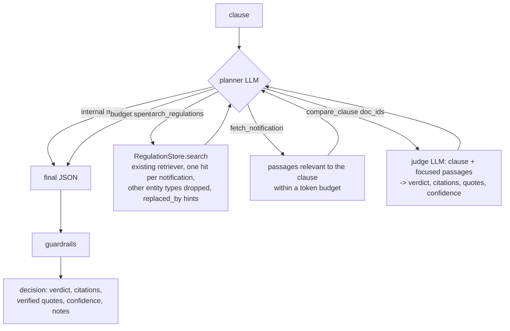

# Compliance agent: design notes and build log

An agent that checks a bank's internal policy document against RBI regulations, clause by
clause, and reports for each clause a verdict (`compliant | conflict | gap |
not_applicable | insufficient_evidence`), the notifications it relied on, and a
confidence score. It reuses this repository's retrieval stack as a tool; nothing in the
RAG pipeline is rebuilt or changed.

## Decisions

| Question | Decision | Why |
|---|---|---|
| Where | A `rbirag.compliance` subpackage in this repository | Imports the retriever, documents, LLM backends and bootstrap code directly; one deployment |
| Framework | A plain, bounded tool-calling loop (no LangGraph) | Per clause the agent takes at most ~6 steps over 3 tools; owning the loop gives full trajectories for tool-call metrics and keeps the existing rate limiter, model fallbacks and response cache (which make free tiers and CI replay workable) |
| Corpus | `corpus-v2`: `corpus-v1` plus notifications above id 13050 | `corpus-v1` has the November 2025 consolidated Directions for NBFCs, UCBs, RCBs and RRBs but not the Commercial Banks set; `corpus-v1` stays untouched so the RAG results remain reproducible |
| Ground truth | "As per the corpus snapshot", with the snapshot date stated | The corpus has no withdrawal flags; the reference graph (below) is a heuristic hint, not truth |
| Headline LLM | Groq free tier for development; a cheap paid model (Claude Haiku 5.5, ~$0.12 per full run) for the reported numbers | A full run is ~0.85M tokens; the Groq free tier allows ~200K tokens per model per day |
| CI | Every push: deterministic replay of the full evaluation from committed LLM responses, failing on a metric regression or a stale cache. Live runs: manual or nightly, resumable | A live evaluation on every push does not fit any free tier |
| Labels | AI-authored from real notifications, every quote machine-checked against the corpus, labelled "0 human-verified" until reviewed | Same honesty rules as the RAG test set |
| Deployment | Hugging Face Spaces (Docker, free CPU tier, 16 GB RAM) | Render's free tier (512 MB) cannot hold torch plus the embedder and reranker |

## Phases

| # | Phase | Status |
|---|---|---|
| 0 | `corpus-v2`: crawl ids above 13050 via `corpus.yml` | done: 2,903 notifications (+750), through 2026-11-11, including 128 Commercial Banks Directions and amendments |
| 1 | Policy loading, clause splitting, reference graph, `search` / `fetch` tools, CLI, tests | done |
| 2 | Labelled clause set, labelling guide, metrics, review tool, tests | done: 89 clauses in 7 policies (26 dev / 63 test); see `data/eval/compliance/README.md` |
| 3 | Agent: tool-calling client, `compare_clause`, loop, guardrails, fixed-pipeline baseline | done (offline-tested; first live runs in Phase 4) |
| 4 | Evaluation runs, results, failure analysis, replay CI + live workflow | |
| 5 | FastAPI endpoints, Streamlit page, Docker, Hugging Face Spaces | |
| 6 | README: architecture, results, limitations | |

## Phase 1: what exists

```
src/rbirag/compliance/
  policy.py       load a policy (.pdf via PyMuPDF, .txt, .md) as clean text
  clauses.py      split it into clauses (numbering, headings, sub-items, paragraphs)
  references.py   citation graph: which notification repeals / supersedes / amends which
  sections.py     passages of a long notification, chosen by relevance within a token budget
  regulations.py  RegulationStore: search (one hit per notification) and fetch
  cli.py          rbirag comply clauses | search | fetch
```

```bash
rbirag comply clauses data/samples/kyc_policy_sample.md
rbirag comply search "Periodic updation of KYC once every three years for high risk customers"
rbirag comply fetch rbi-11566 --query "periodic updation high risk customers"
```

### Clause splitting

Decimal-numbered lines (`3.1`, `Clause 4`, `7.`) start clauses. A numbered line is a
heading when it is short, unpunctuated and followed by its own sub-clauses. Lettered,
roman and bulleted sub-items stay inside their parent clause. Markdown and title-case
headings form the heading path. Unnumbered text falls back to blank-line paragraphs. A
number that continues the previous line (`... under section` / `5.2 of the Act`, common in
PDF text) does not start a clause. Clause offsets round-trip exactly into the source text.
Segmentation accuracy is measured in Phase 2 against the synthetic policies.

### Reference graph

Notifications cite what they change by circular number, department reference number, or
the full title of a Master Direction. Each citation is labelled with the strongest
relation stated by:

1. an enclosing section heading (`8. Repeal Provisions`) or the citing notification's
   title (`Amendment to the Master Direction - ...`, `... - Withdrawal of Circulars`);
2. otherwise, the sentence containing the citation (`... stands withdrawn`,
   `This circular supersedes ...`).

The boilerplate phrase "as amended from time to time" is ignored. An older notification
never cites a newer one.

On `corpus-v1` (2,153 notifications) the graph has about 2,170 citations: 2,069
mentions, 58 amends, 30 supersedes and 12 repeals. 35 notifications are marked as
replaced. Spot checks of the repeal and supersede labels were mostly correct after the
heading and sentence rules. **Recall is low by design.** The 2025 consolidated Directions
repeal older circulars "as communicated vide circular DOR.RRC.REC.302/..." rather than
listing them, and that circular is not in `corpus-v1`. The agent therefore also has to
reason from dates and titles. The "outdated rule" items in the Phase 2 test set measure
how well it does.

### Search and fetch

- `search` runs the existing retriever (same modes, fusion, reranker and confidence as the
  reported RAG results). It retrieves `top_k x 4` chunks, keeps the best chunk per
  notification, and returns notifications with date, circular number, a snippet and any
  `replaced_by` hints. Date filters retrieve deeper before filtering.
- `fetch` accepts a doc id, a bare RBI id, a circular number or a reference number. It
  returns metadata, the table of contents, later citing notifications, and the passages
  most relevant to the clause (BM25 within the notification). Passages are kept in
  document order within a token budget (default 1,500). The largest notification is 235K
  characters, so full text is never returned.

### On `corpus-v2`

The graph has about 3,950 citations: 3,071 mentions, 509 amends, 71 supersedes and 294
repeals. 93 notifications are marked as replaced. The 2026 amendment Directions name what
they repeal, which is why repeals rose. Building the graph takes about 16 s, so the API
will cache it (Phase 5).

### Early observation for Phase 3

For a KYC clause, search returns the NBFC, UCB and RRB versions of the 2025 KYC
Directions next to the commercial-bank Master Direction. The agent must check the
addressee and entity of each notification before relying on it. Wrong-entity citations
will be a tracked failure category.

On `corpus-v2` the problem is sharper. For the clause "periodic updation ... every three
years for high risk customers", BM25 ranks the 2016 KYC Master Direction first. The graph
correctly flags it as replaced by `rbi-13171`. But
`Reserve Bank of India (Commercial Banks - Know Your Customer) Directions, 2025`
(`rbi-13141`) is not in the top 5, behind the NBFC, UCB, RRB and ARC versions. Phase 3
will therefore give `search_regulations` an entity option that prefers notifications
whose title or addressee names the target entity, and compare it with plain search in
the evaluation.

## Phase 2: what exists

```
data/eval/compliance/
  policies.json, labels.jsonl   the labelled set (source of truth)
  policies/*.md                 policy documents rendered from it
  LABELING.md, README.md        labelling rules and dataset card
src/rbirag/compliance/
  records.py                    ClausePrediction / ToolCall: what a system must output
  evaluation/dataset.py         schema, validation, rendering, gold check
  evaluation/metrics.py         all metrics, bootstrap CIs, failure taxonomy
  evaluation/segmentation.py    clause-splitting P/R/F1 (text and PDF)
  evaluation/report.py, cli.py  markdown reports; rbirag comply eval ...
results/compliance/
  gold_check.json               every citation and quote verified against corpus-v2
  segmentation.json             1.00 F1 on text and PDF (tidy synthetic documents)
```

### How the set was built

1. Four research passes, each on two topics, extracted requirements from `corpus-v2`
   as verbatim quotes, each one checked against the corpus. They also listed older
   versions with different values, other entity types' versions, and topics the
   corpus does not cover (absence shown by search).
2. Clauses and labels were written from those requirements, following `LABELING.md`.
   The tricky clauses come from documented differences: older rules, other entity
   types, amendments and future effective dates.
3. Every quote was re-verified (`rbirag comply eval check`). Every policy is rendered and
   split back into exactly its gold clauses. The structural rules are enforced by
   `validate_dataset`.

### Metric definitions (see `evaluation/metrics.py`)

| Metric | Definition |
|---|---|
| verdict accuracy, macro-F1 | over the 5 verdicts; abstaining correctly (`insufficient_evidence`) counts as correct |
| citation precision | cited notifications that are gold or acceptable / all cited (micro) |
| citation recall | gold citation groups with at least one cited member / groups (mean over clauses with gold) |
| tool-argument validity | valid tool calls / tool calls |
| fetch grounding | fetches of a notification shown by an earlier search / fetches |
| tool-selection accuracy | expected tools used, `compare_clause` before any substantive verdict, within the step budget (8) |
| task success | correct verdict, all gold groups cited, no invalid call, no error |
| cost / latency | steps, LLM calls, tokens, USD and seconds per clause and per document |
| calibration | ECE (10 bins) and accuracy at 50/80/100% coverage when ranked by confidence |
| failures | first matching type, in this order: run error, unsupported verdict, over-abstention, scope error, wrong entity, outdated rule missed, missed issue, false alarm, conflict/gap confusion, citation miss, invalid tool call, step budget |

Intervals are 95% percentile bootstraps (1,000 resamples, seed 13) over clauses, or over
documents for per-document numbers. `paired_bootstrap_difference` compares the agent
with the baseline on the same clauses.

### CI

The new `compliance-gold` job in `ci.yml` downloads `corpus-v2`, re-checks every
citation and quote, confirms the committed `gold_check.json` is current, and runs the
segmentation score. The offline test job validates the set's structure and checks that
the rendered policies are current.

## Phase 3: the agent

```
src/rbirag/compliance/
  llm.py        tool-calling chat client for Groq / Gemini / Ollama (OpenAI-compatible),
                response cache with a replay mode, scripted fake for tests
  tools.py      search_regulations, fetch_notification, compare_clause: schemas,
                strict argument validation, execution, trajectory
  judge.py      compare_clause: focused passages -> one JSON judgement; quote checks
  prompts.py    planner and judge prompts (verdict definitions = LABELING.md)
  guards.py     proposal -> decision (citation, entity, evidence and threshold rules)
  agent.py      the bounded tool-calling loop
  baseline.py   fixed pipeline: search -> top-3 -> judge (no agency)
  checker.py    whole document: split, check each clause, Markdown / JSON report
  evaluation/run.py   resumable runs over the labelled set
```

```bash
rbirag comply check data/samples/kyc_policy_sample.md --out report.md
rbirag comply eval run --system agent --split dev      # writes results/compliance/predictions/
rbirag comply eval run --system baseline --split dev
```

### How a clause is checked



- **Budget:** at most 8 tool calls. When it is spent, the planner is asked for its answer
  with tools disabled. A malformed final answer gets one repair prompt; after that the
  last `compare_clause` judgement is adopted.
- **Tool validation:** calls are validated strictly (known tool, JSON object, required
  and only allowed arguments, ids that resolve). An invalid call is not executed: the
  model gets the error and the call is recorded as invalid. An identical repeated call
  returns the earlier result but still uses a step.
- **Text tool calls:** models that write a tool call as JSON text instead of using the
  tools API (common with small local models) are accepted, and the call is recorded.
- **Guardrails** (`guards.py`):
  - citations not shown by a search or fetch are dropped, and so are other entity
    types' Directions;
  - `compliant`, `conflict` or `gap` need a `compare_clause` result, a remaining citation
    and an evidence quote verified against the passages read; otherwise the verdict is
    `insufficient_evidence`;
  - confidence is discounted for dropped citations, replaced sources and unverified
    quotes;
  - verdicts below the abstention threshold (tuned on dev in Phase 4) also become
    `insufficient_evidence`.
- **Failure handling:** quota exhaustion, configuration errors and replay-cache misses
  stop a run, and what was predicted so far is kept. Any other failure is recorded as
  that clause's error.
- **Latency** is the sum of the recorded LLM and tool latencies, so live and replayed
  runs report the same numbers.

### Checked against the real corpus (offline, scripted model)

- **Entity filter:** for the sample KYC clause, it drops 9 other-entity hits. The
  commercial-bank KYC Directions (`rbi-13141`) move from outside the top 5 to second.
  The 2016 Master Direction ranks first, flagged as replaced by `rbi-13171`.
- **Passages:** focused selection puts the deciding paragraph (para 42(1) of `rbi-13141`,
  para 38 of `rbi-11566`) in front of the judge, even though both notifications are over
  100K characters.
- **Prompt sizes:** about 0.9K, 1.8K and 1.8K tokens for the planner turns and 3.8K for the
  judge, roughly 8.4K tokens per clause. On the Groq free tier (about 8K tokens per
  minute, 200K per day for `gpt-oss-20b`) that is about one clause a minute and roughly
  24 clauses a day. This is why the headline run needs a paid model or Ollama.
- **Load time:** the store loads in about 22 s, of which the reference graph takes about
  16 s. Phase 5 caches the graph for the API.

No live LLM run has happened yet: this environment has no provider key and its network
blocks the providers. The first live runs (dev split) happen in Phase 4 in GitHub Actions
using the repository's `GROQ_API_KEY` secret.
